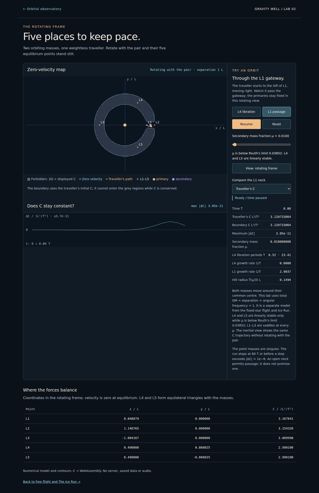
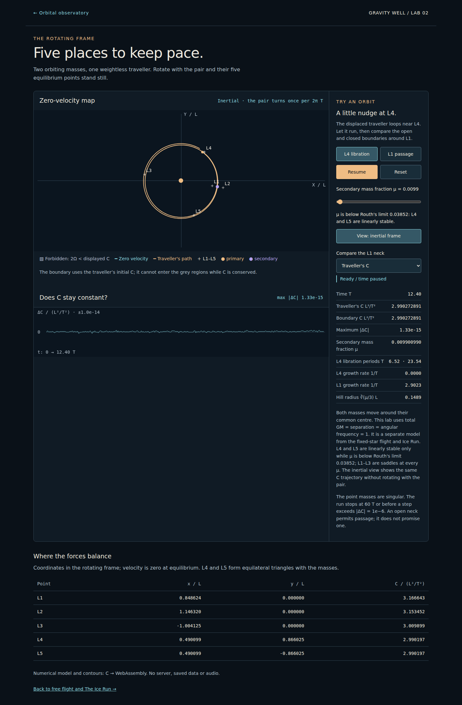
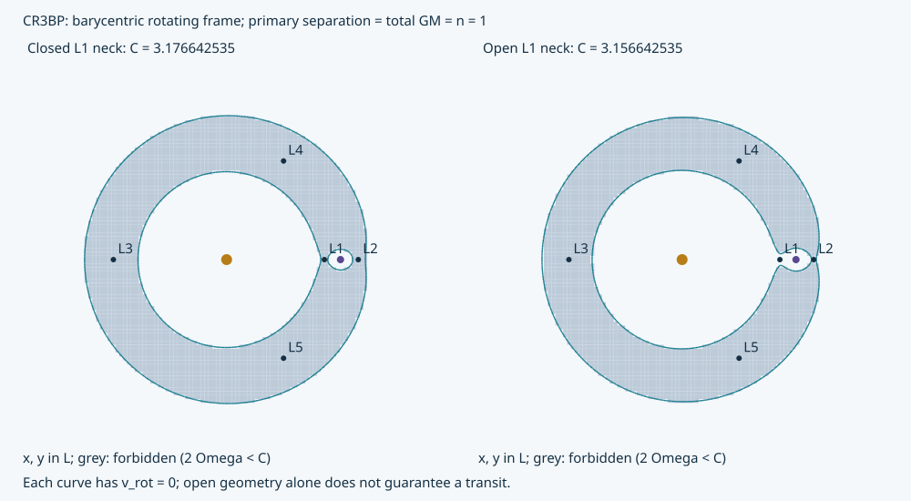
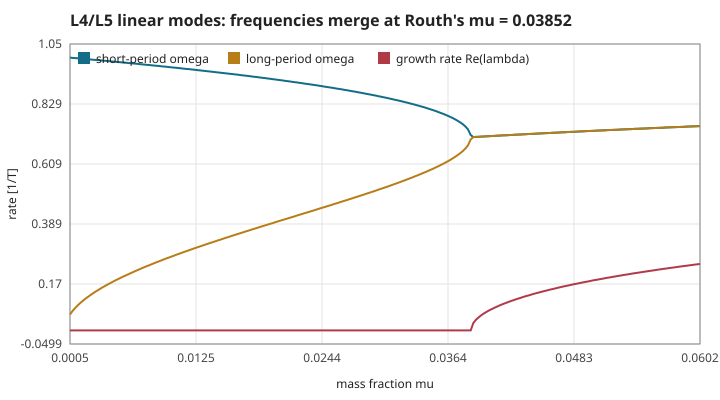
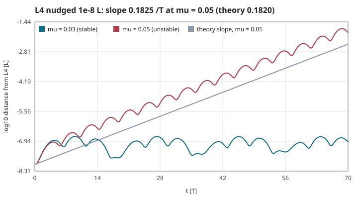

# Gravity Well — Orbital Observatory

重力井戸の中で宇宙船を操作し、月とランデブーする C11 の軌道力学シミュレーター。
船首を向けても進路はすぐに変わらない。短い噴射が軌道を変え、その後は慣性と重力で進む。
velocity-Verlet 積分による同じ C の計算を、端末とブラウザーの両方で実行できる。

**理論の手引き / Theory handbook**: [docs/theory/](docs/theory/README.md) — 34 statements(重力・ケプラーの法則・vis-viva・Hohmann 遷移・velocity Verlet・The Ice Run・回転座標系の制限三体問題)を、式・前提・導出・実装箇所・検査と図つきで説明する。図と実測値は `make theory-figs` で再生成、`make theory-check` で対応表を検査。


## 起動

C11 コンパイラーと Make があれば端末版を実行できる。

```sh
make
./gravity-well                 # 対話端末
./gravity-well --snapshot      # 標準出力に1フレーム
./gravity-well --gif demo.gif  # 決定的な遷移デモ
make test
make bench
make story                    # The Ice Run の bench(docs/narrative の3ファイル)を再生成
make story-check              # 全行を作り直してバイト一致を確認
make plots                    # docs の CSV / SVG / GIF を再生成
make theory-figs              # docs/theory の図と実測値の表を再生成
make theory-check             # 手引きの対応表(文 → 頁 → 図 → 関数 → テスト)を検査
make lagrange-plots           # L1〜L5・ヤコビ定数・ゼロ速度曲線の CSV/SVG
./gravity-well --lagrange .   # 同じ出力を指定した既存ディレクトリへ
```

ブラウザー版は Emscripten の `emcc` と Python 3.14 を PATH に置いて実行する。

```sh
make play
```

表示された localhost のポート4216をブラウザーで開く。
「Fly the ice run」で物語の航行、「Take control」で手動航行、「Watch a Hohmann transfer」で2回の噴射による遷移を見る。
手動航行は `a` / `d` で旋回、`w` を押して噴射。The Ice Run は `w` で増速、`s` で減速、`m` で円軌道合わせ。
`p` で一時停止。画面のボタンも押し続けられる。
端末版は `q` で終了する。音声・保存・外部 API は無い。

## Lagrange laboratory(回転座標系の制限三体問題)

「Explore Lagrange points」から、重心とともに回る別の観測画面へ進む。
L1〜L5の座標表、ゼロ速度曲線、到達できない灰色領域、軌道に沿ったヤコビ定数の誤差を見る。
「L4 libration」は正三角形の点から少しずらした軌道、「L1 passage」は2天体の間を通過する軌道。
Pause/Reset と L1 の開いた/閉じた曲線の比較ができる。比較曲線の C と実軌道の C は別々に表示する。
質量比 μ のスライダー(0.001〜0.5)で5点・ゼロ速度曲線・線形安定性(L4 の秤動周期、成長率、Routh の限界 0.03852)が変わり、
「View」で同じ C の軌道を回転座標系と慣性系で切り替えて見る。





主星間隔=1 L・全GM=1 L³/T²・角速度=1 T⁻¹、既定の質量比は1:100(mu=1/101)。
両天体が重心のまわりを回る標準モデルで、星を固定した従来の手動航行とは別の計算。
軟化は使わず、コリオリ項を含む速度依存の加速度を RK4・刻み0.0025 Tで進める。
60 Tで観測終了。近接や誤差1e−6超のステップは受理せず、最後の受理状態で停止する。

| 検査 | 理論・独立基準 | 実測 |
|---|---|---|
| L1〜L3(6質量比) | 独立した長倍精度Newton法の根との差≤1e−6 L | 最大2.22e−16 L |
| L4・L5 | (1/2−mu, ±sqrt(3)/2)・両天体まで距離1 | 三角形・ヤコビ定数の式を1e−14以内で照合 |
| Cの保存(3軌道×60 T) | 最大絶対誤差≤1e−6 L²/T² | 9.36e−8 |
| ゼロ速度曲線の端点 | 2Ω−C=0 | 最大残差7.55e−15 |
| 3解像度のRK4位置差比 | 4次精度の差比17 | 17.40 |
| native/WASM(100行×21値) | 同時刻・同初期条件 | 最大相対差1.44e−15 |
| 回転系 ⇄ 慣性系 | 往復で元に戻る、C=−2(E−h) | 往復8.9e−16、差5.3e−15 |
| 慣性系で独立に積分(見かけの力なし、20 T) | 回転系の軌道を変換した位置 | 差1.29e−8 L |
| L1〜L3 の成長率(5質量比×3点) | 線形化の固有値 | 相対差 最大1.85e−5(mu=1/101: 2.9023, 2.1806, 0.1607 /T) |
| L4 の秤動周期(短・長) | 2π/ω = 6.519729, 23.539634 T | 6.519732, 23.539611 T(相対差5.2e−7, 1.0e−6) |
| Routh の臨界質量比 | (1−√(23/27))/2 = 0.0385208965 | 成長率が0でなくなる点の二分法と1e−12以内 |
| L4 を1e−8 L ずらして70 T | mu=0.03 は有界、mu=0.05 は成長率0.18199 /T | 最大1.92e−7 L / 0.0177 L へ発散、傾き0.18253(0.3%) |
| Hill 半径 (mu/3)^(1/3) = 0.148886 L | 小質量比での L1・L2 の距離の近似 | L1 0.141475(−4.98%)、L2 0.156221(+4.93%) |







図・座標表・1,501時点の軌道CSV・ヤコビ誤差グラフは `make lagrange-plots` で再生成する。
理論と制約は[第5頁](docs/theory/05-rotating-three-body.md)。曲線の形は有限格子による近似であり、
通過口が開いても、どんな初期条件でも通れるという意味ではない。

## The Ice Run(物語の航行)

内側の港に残った最後の氷を、外側の灯台港 Lamp Quay へ5区間で運ぶ。
港長 Ilse は燃料を分けて送り出し、無線で噴射の合図を出す。
Lamp Quay の管制係 Pell は、水を半分に減らして待っている。
途中で太陽フレアが3週間早く来て、Ilse は港を離れないと告げる。

各区間は星のまわりの円軌道から円軌道への遷移。
増速(Raise)か減速(Lower)を、破線の軌道が緑の目標輪に触れるまで押す。
輪まで惰性で進み、円軌道合わせ(Match)で丸くする。
燃料は届けるはずの氷そのもので、空になると救援が来る。
この救援は失敗に数える。積分は `src/orbit.c` のまま、月の引力は切っている。月は位置の参考として描く。

選択は2つ。どちらの道にも、時計か燃料の得と損がある。

- 近い灯台は上昇が短い。遠い灯台は上昇が長いが、番人が予備燃料を送ってくる。
- Ilse の燃料ポッドへ戻るか、そのまま Lamp Quay へ向かうか。
  戻ると寄り道とポッドの給油待ちで遅くなるが、燃料が戻る。結末も変わる。


物語の数値と選択の効き目は `make story` が自動操縦で測る。
発火順、効き目の有無、道ごとの差、区間ごとの危機を `docs/narrative/` に書き出す。
`make test` は数値を `[mech]` で、重い場面を `[quiet]` で確かめる。
bench の行を再実行し、ファイルと一字一句一致することも求める。
行は libm の丸めまで一致させる。ローカルは互換コンパイラで `make story-check` を通し、
既存 CI の Debian 13 でも同じファイルを照合する。

## 観測画面で分かること

船の上面図が船首方向、青い矢印が速度、金の実線が通った軌道。
矢印は `速度 × 0.45 T` の長さで、破線は半径1・2・3の参考円。
月は輪の記号で、色に加えて形と線種でも区別する。
画面外へ飛ぶと尺度が自動調整され、目盛りの間隔も更新される。
ヘッダーは装飾画、地図は計算結果。船と星の記号は実際の寸法より拡大している。


### スマートフォン

開くと観測画面の上に「Start the ice run」の案内が出る。タップだけで物語の航行を始められる。
縦持ちは上から観測画面、操作ボタン、データ、装飾画の順に並べ、観測画面が画面の半分以上を占める。
横持ちは観測画面を左に画面の高さいっぱいで置き、操作とデータを右に並べる。
文字はすべて14 CSS px以上、押せる物はすべて44×44 CSS px以上にしている。
場面の選択肢は場面の下端に固定し、長い場面でもスクロールせずに押せる。


変更前の C レンダラーが生成した GIF の実フレーム。端末版と GIF 出力は現在も使える。


## 物理モデルとモードの違い

星の `GM = 1`、距離を L、時間を T とする無次元系。原点の星と半径3の円軌道を動く月が
テスト質量の船に引力を及ぼす。近距離の特異点は軟化している。
手動航行の成功条件は月までの距離 `< 0.15 L` かつ月との相対速度 `< 0.25 L/T`。
星からの距離 `< 0.1 L` は衝突。表示するエネルギーは星に対する値だけで、月の重力や噴射中の保存量ではない。

ブラウザーの Hohmann 実演と CSV/SVG は月の重力を切り、星だけの場で半径1→2を検査する。
The Ice Run も星だけの場で、船のエンジンは手動航行より強い加速度0.1を使う(積分器は同じ)。
月は実演中も位置の参考として表示する。従来の GIF は月の弱い重力を含むため、完全な円にはならない。
この違いを画面と検証記録に明記している。
[NASA の軌道解説](https://science.nasa.gov/learn/basics-of-space-flight/chapter4-1/)も参照した。

## 検証

`make test` は既存の軌道・保存則・GIF 往復検査に加え、The Ice Run の場面順・物語の数値・重い場面の静けさ・2つの選択の得と損を検査する。
さらに手動航行が既存積分と100フレームで一致すること、
2回の噴射と停止・リセットを検査する。`make bench` は解析値との比較を行い、閾値を超えたら失敗する。
実測は第1噴射 Δv=0.154706、Web 実演の最終半径2.000127。

ブラウザーの操作検査・実画面撮影はローカルで行う（Node.js と Playwright が必要）。

```sh
npm ci
npx playwright install chromium
make smoke
```

既存航行の36項目に加え、Lagrange画面のnative/WASM照合・実操作・PC/スマートフォン縦横・停止/復帰を検査する。
The Ice Run を実キーと実クリックで両方の結末まで航行する検査を含む。
各観測画面のWASMと原画を合わせた配布容量は `make web` が全ファイルから導出し、10,000,000 B以下を強制する。
要件は [docs/requirements.md](docs/requirements.md)、構成は [docs/design.md](docs/design.md)。
詳細は [検証記録](docs/validation.md)、[機械記録](docs/validation.json)、[原画の生成指示と採否](docs/art-direction.md)。
人間の初見試遊、実スマートフォン、各ブラウザーでの操作は未検証。公開配信は行っていない。


Lagrange点は [M2 #2](https://github.com/TM-59/gravity-well/issues/2)で追加。
後続は[重力アシスト #3](https://github.com/TM-59/gravity-well/issues/3)。
[C 物理シリーズ](https://github.com/TM-59/algo-vis-panel/issues/6)の一作。MIT licensed.
