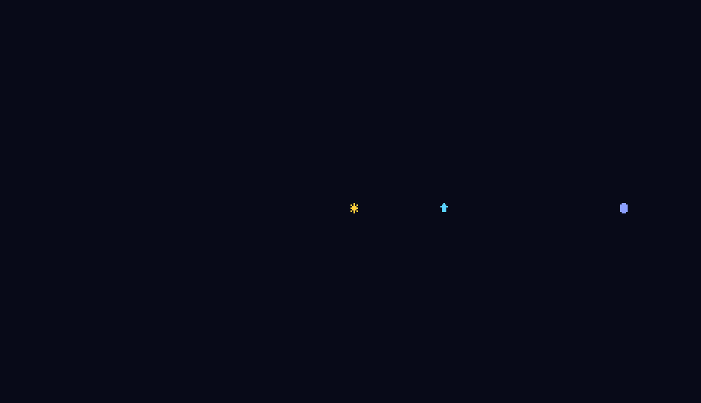
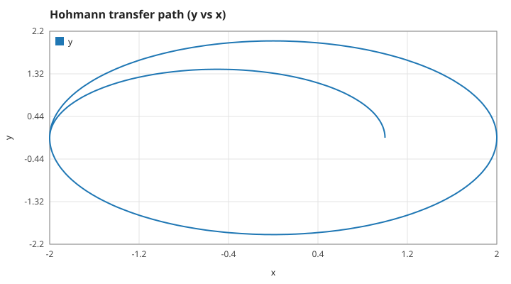
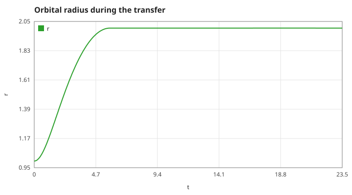
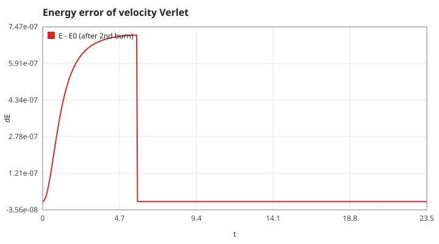

# gravity-well

Pilot a spacecraft through a star's gravity well and rendezvous with a moon. A C11 orbital-mechanics toy: velocity-Verlet (symplectic) integration, a restricted star + moon field, and a top-view ASCII cockpit.
(C言語の軌道力学シミュレータ。重力場の中で宇宙船を操作し、月とランデブーします。)



## Run

```sh
make && ./gravity-well          # interactive
./gravity-well --snapshot       # one frame, no terminal needed
./gravity-well --gif docs/demo.gif  # scripted Hohmann transfer as an animated GIF
make test && make plots         # unit tests and docs/*.svg
docker build -t gravity-well .  # same, reproducibly
```

Keys: `a`/`d` turn, `w` burn (hold), `p` pause, `q` quit. Reach the moon `o` within 0.15 units at a relative speed below 0.25.

## Model

Units with the star's `GM = 1` at the origin; the ship is a test mass with acceleration `a = −GM·r/|r|³ − GM_moon·(r − r_moon)/|r − r_moon|³ + thrust`. The moon follows an exact circular orbit of radius 3.

## Results

A Hohmann transfer from r = 1 to r = 2 with two impulsive burns. The first burn is Δv = 0.1547, exactly the textbook value, and the ship reaches r = 2.0000 at apoapsis.





## Tests

`tests/test_orbit.c` checks: circular period vs Kepler (1 %), bounded energy error and conserved angular momentum over 100k steps, escape speed gives zero energy and the ship leaves, Hohmann apoapsis, moon geometry, thrust raising energy, renderer bounds.

## Roadmap

See the Issues: full N-body with a moving star, Lagrange points, gravity-assist scoring.

Part of a series of small C physics toys, tracked in [algo-vis-panel](https://github.com/TM-59/algo-vis-panel/issues/6). MIT licensed.
