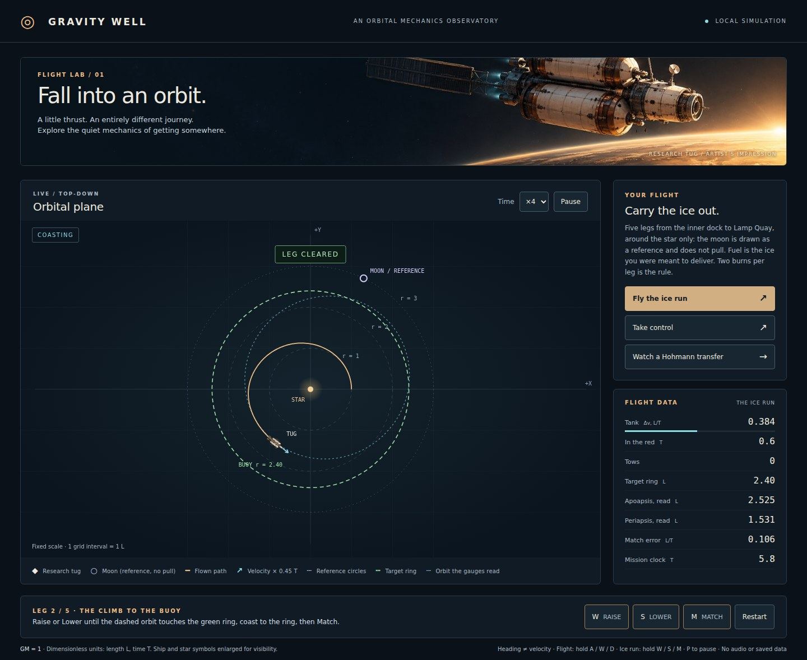
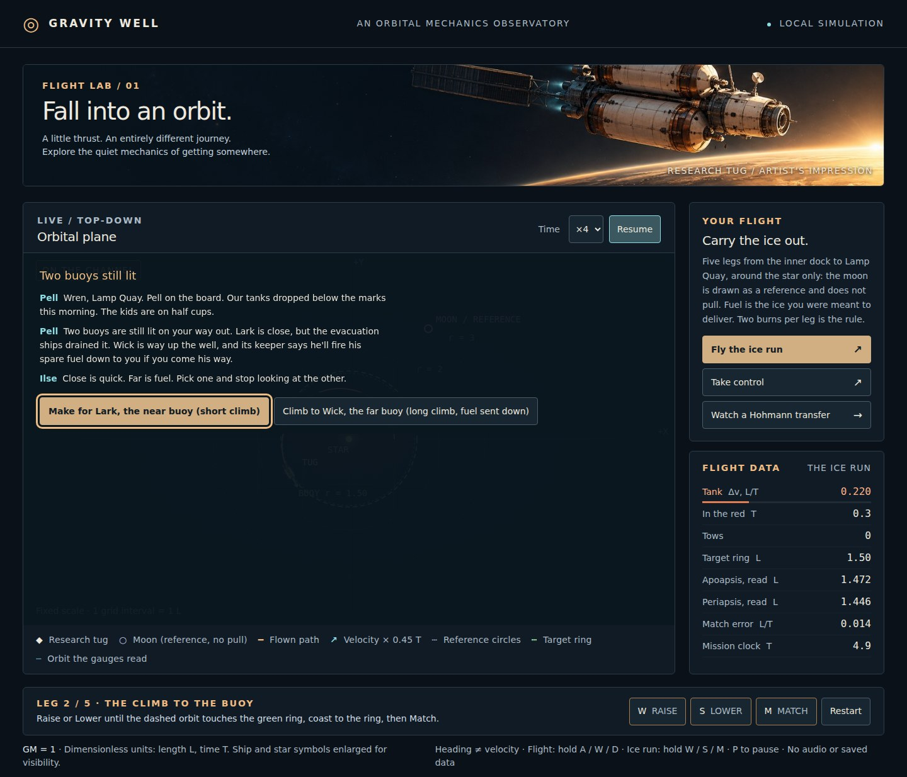
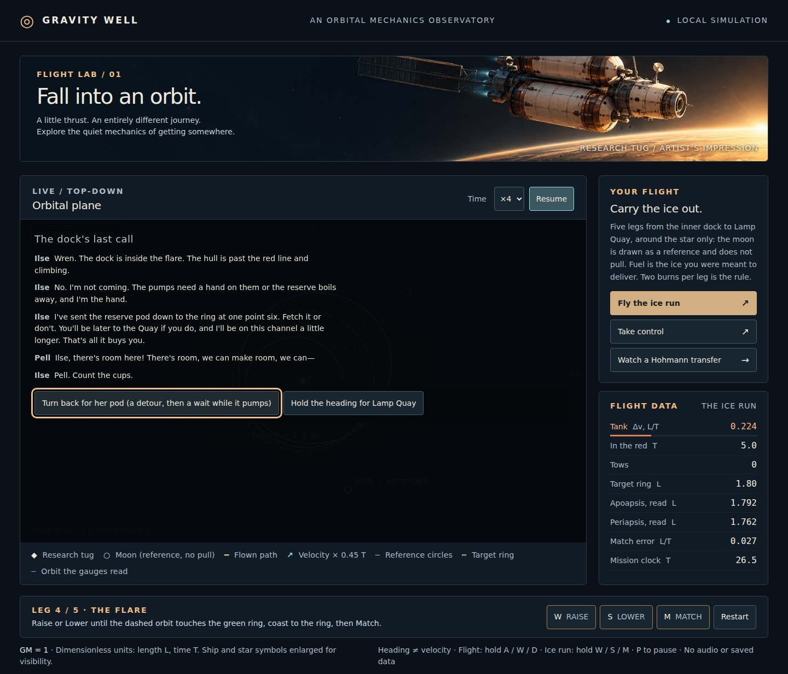
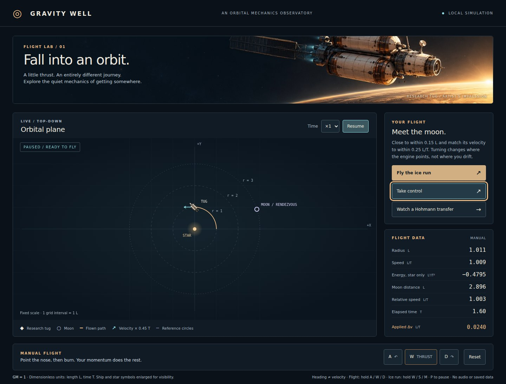
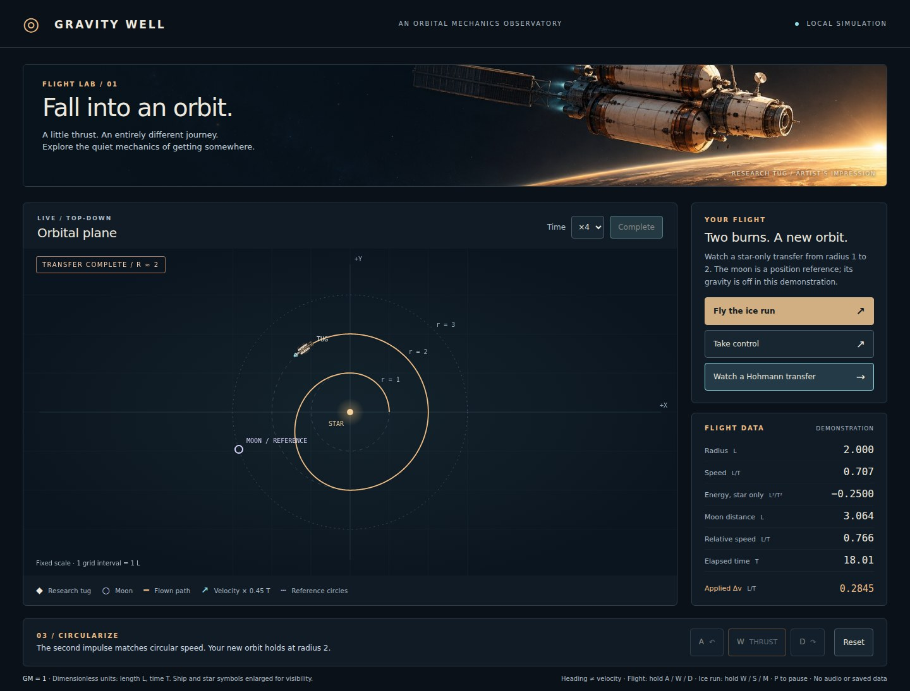
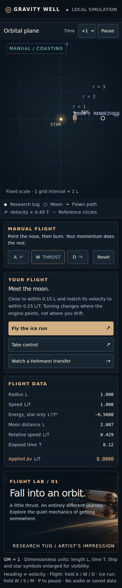
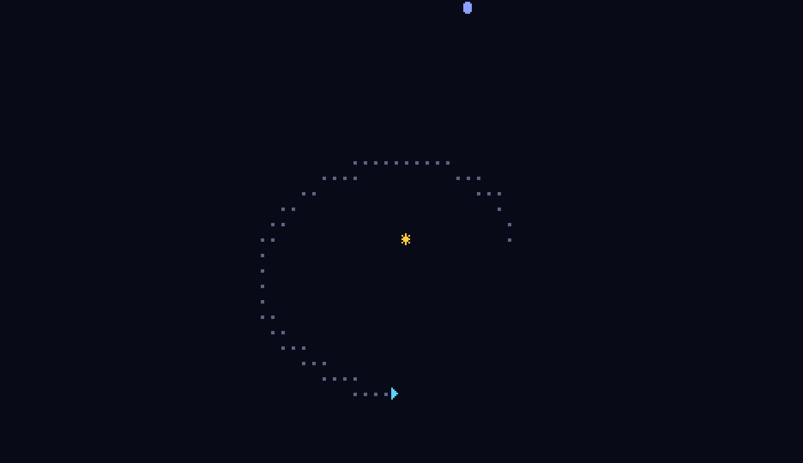
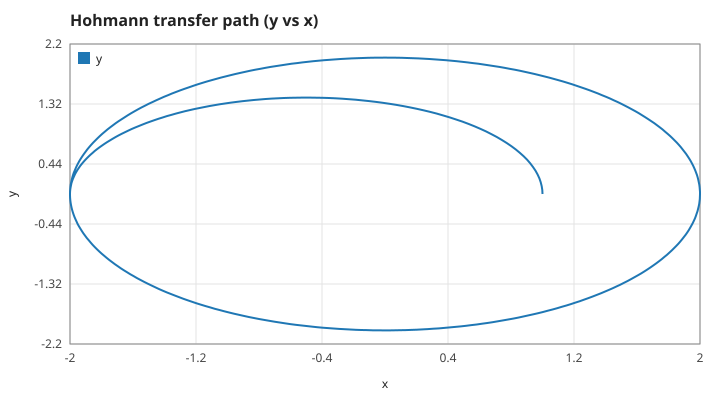
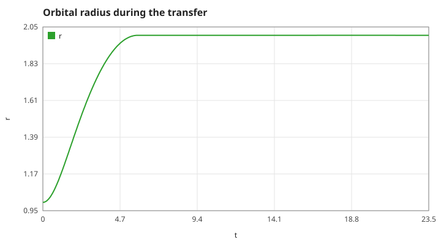
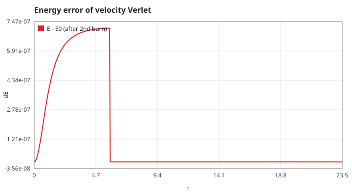

# Gravity Well — Orbital Observatory

重力井戸の中で宇宙船を操作し、月とランデブーする C11 の軌道力学シミュレーター。
船首を向けても進路はすぐに変わらない。短い噴射が軌道を変え、その後は慣性と重力で進む。
velocity-Verlet 積分による同じ C の計算を、端末とブラウザーの両方で実行できる。


## 起動

C11 コンパイラーと Make があれば端末版を実行できる。

```sh
make
./gravity-well                 # 対話端末
./gravity-well --snapshot      # 標準出力に1フレーム
./gravity-well --gif demo.gif  # 決定的な遷移デモ
make test
make bench
make story                    # The Ice Run の bench(docs/narrative の3ファイル)を再生成
make story-check              # 全行を作り直してバイト一致を確認
make plots                    # docs の CSV / SVG / GIF を再生成
```

ブラウザー版は Emscripten の `emcc` と Python 3.14 を PATH に置いて実行する。

```sh
make play
```

表示された localhost のポート4216をブラウザーで開く。
「Fly the ice run」で物語の航行、「Take control」で手動航行、「Watch a Hohmann transfer」で2回の噴射による遷移を見る。
手動航行は `a` / `d` で旋回、`w` を押して噴射。The Ice Run は `w` で増速、`s` で減速、`m` で円軌道合わせ。
`p` で一時停止。画面のボタンも押し続けられる。
端末版は `q` で終了する。音声・保存・外部 API は無い。

## The Ice Run(物語の航行)

内側の港に残った最後の氷を、外側の灯台港 Lamp Quay へ5区間で運ぶ。
港長 Ilse は燃料を分けて送り出し、無線で噴射の合図を出す。
Lamp Quay の管制係 Pell は、水を半分に減らして待っている。
途中で太陽フレアが3週間早く来て、Ilse は港を離れないと告げる。

各区間は星のまわりの円軌道から円軌道への遷移。
増速(Raise)か減速(Lower)を、破線の軌道が緑の目標輪に触れるまで押す。
輪まで惰性で進み、円軌道合わせ(Match)で丸くする。
燃料は届けるはずの氷そのもので、空になると救援が来る。
この救援は失敗に数える。積分は `src/orbit.c` のまま、月の引力は切っている。月は位置の参考として描く。

選択は2つ。どちらの道にも、時計か燃料の得と損がある。

- 近い灯台は上昇が短い。遠い灯台は上昇が長いが、番人が予備燃料を送ってくる。
- Ilse の燃料ポッドへ戻るか、そのまま Lamp Quay へ向かうか。
  戻ると寄り道とポッドの給油待ちで遅くなるが、燃料が戻る。結末も変わる。







物語の数値と選択の効き目は `make story` が自動操縦で測る。
発火順、効き目の有無、道ごとの差、区間ごとの危機を `docs/narrative/` に書き出す。
`make test` は数値を `[mech]` で、重い場面を `[quiet]` で確かめる。
bench の行を再実行し、ファイルと一字一句一致することも求める。
行は libm の丸めまで一致させるため、Dockerfile の Debian 13 でビルドする。
CI も `docker build .` で同じ環境を使う。

## 観測画面で分かること

船の上面図が船首方向、青い矢印が速度、金の実線が通った軌道。
矢印は `速度 × 0.45 T` の長さで、破線は半径1・2・3の参考円。
月は輪の記号で、色に加えて形と線種でも区別する。
画面外へ飛ぶと尺度が自動調整され、目盛りの間隔も更新される。
ヘッダーは装飾画、地図は計算結果。船と星の記号は実際の寸法より拡大している。








変更前の C レンダラーが生成した GIF の実フレーム。端末版と GIF 出力は現在も使える。



## 物理モデルとモードの違い

星の `GM = 1`、距離を L、時間を T とする無次元系。原点の星と半径3の円軌道を動く月が
テスト質量の船に引力を及ぼす。近距離の特異点は軟化している。
手動航行の成功条件は月までの距離 `< 0.15 L` かつ月との相対速度 `< 0.25 L/T`。
星からの距離 `< 0.1 L` は衝突。表示するエネルギーは星に対する値だけで、月の重力や噴射中の保存量ではない。

ブラウザーの Hohmann 実演と CSV/SVG は月の重力を切り、星だけの場で半径1→2を検査する。
The Ice Run も星だけの場で、船のエンジンは手動航行より強い加速度0.1を使う(積分器は同じ)。
月は実演中も位置の参考として表示する。従来の GIF は月の弱い重力を含むため、完全な円にはならない。
この違いを画面と検証記録に明記している。
[NASA の軌道解説](https://science.nasa.gov/learn/basics-of-space-flight/chapter4-1/)も参照した。

## 検証

`make test` は既存の軌道・保存則・GIF 往復検査に加え、The Ice Run の場面順・物語の数値・重い場面の静けさ・2つの選択の得と損を検査する。
さらに手動航行が既存積分と100フレームで一致すること、
2回の噴射と停止・リセットを検査する。`make bench` は解析値との比較を行い、閾値を超えたら失敗する。
実測は第1噴射 Δv=0.154706、Web 実演の最終半径2.000127。

ブラウザーの操作検査・実画面撮影はローカルで行う（Node.js と Playwright が必要）。

```sh
npm ci
npx playwright install chromium
make smoke
```

36項目成功、console error / 外部通信とも0件。The Ice Run を実キーと実クリックで両方の結末まで航行する検査を含む。
WASM 17,055 B、原画込みの初期ダウンロード343,007 B。
詳細は [検証記録](docs/validation.md)、[機械記録](docs/validation.json)、[原画の生成指示と採否](docs/art-direction.md)。
人間の初見試遊、実スマートフォン、各ブラウザーでの操作は未検証。公開配信は行っていない。





後続は [Lagrange 点 #2](https://github.com/TM-59/gravity-well/issues/2)、
[重力アシスト #3](https://github.com/TM-59/gravity-well/issues/3)。
[C 物理シリーズ](https://github.com/TM-59/algo-vis-panel/issues/6)の一作。MIT licensed.
