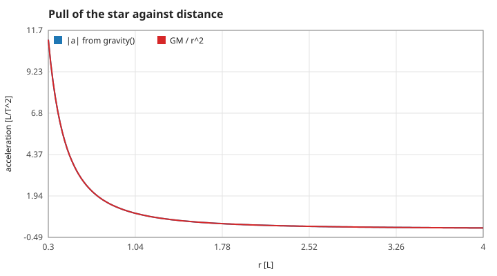
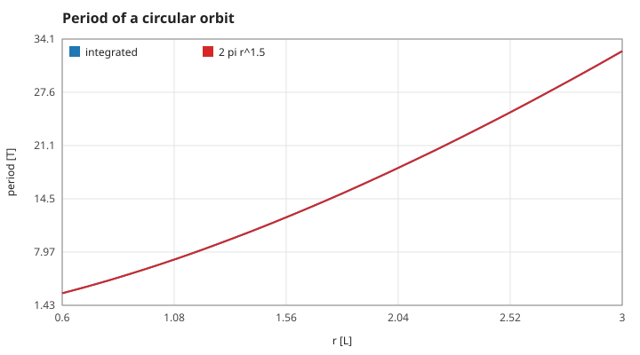
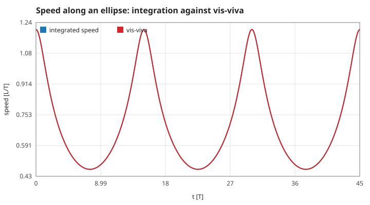
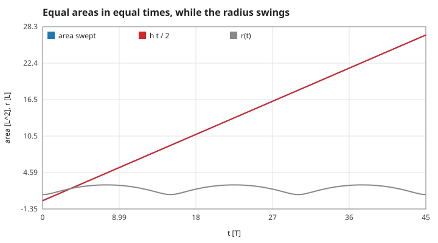
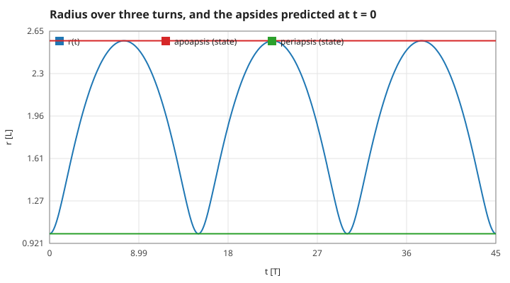
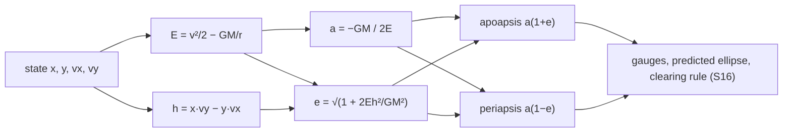
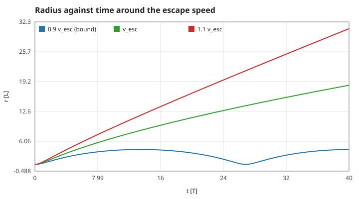
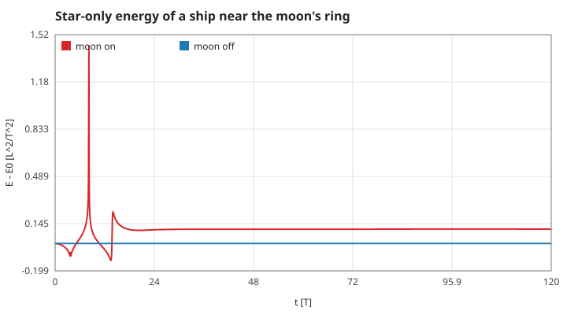

# 1. Gravity and orbits

Units throughout: lengths in L, times in T, chosen so that the star's gravitational parameter is $GM = 1$ (`world_default`, `star_gm`). The star sits at the origin and does not move; the ship is a test mass (it pulls on nothing). Measured numbers are quoted by their id in [figures/values.md](figures/values.md).

[Back to the index](README.md)

## S01 — Newtonian gravity of the star (and the moon)

**Statement.** A ship at position $\mathbf r = (x, y)$ is accelerated towards the star by

$$\mathbf a = -\frac{GM}{(r^2 + \epsilon)^{3/2}}\,\mathbf r, \qquad r = |\mathbf r|, \quad \epsilon = 1\times10^{-6}\ \mathrm{L}^2 .$$

With $\epsilon = 0$ this is Newton's inverse-square law, $|\mathbf a| = GM / r^2$ [Newton 1687, Book III; Curtis 2020, §2.2]. In the manual mode the moon adds a second term of the same form, with $GM_m = 0.01$, the ship's position measured from the moon, and a softening of $1\times10^{-4}$.

**Assumptions and where they break.** Point masses; the star is fixed (its mass is taken as infinitely larger than the ship's and the moon's); no relativity. The softening $\epsilon$ is a numerical guard that keeps the force finite at $r = 0$. It changes the pull by a relative $1.5\,\epsilon / r^2$: one and a half parts in a million at $r = 1$ (`accel-r1`), one and a half parts in ten thousand at $r = 0.1$ (`accel-softening-r0.1`), which is the radius where the manual mode already counts a crash (S11). Inside that radius the formula is no longer Newton's.

**Derivation.** The inverse-square law is taken as given. Its direction is along $-\mathbf r$ because the force is central; the code divides the vector $\mathbf r$ by $r^3$ rather than a unit vector by $r^2$, which is the same thing and avoids a second square root (`accel-direction` confirms the components are in the ratio $x : y$).

**Code.** `gravity` in `src/orbit.c`: `r2 = x*x + y*y + 1e-6`, `r3 = r2 * sqrt(r2)`, then `ax = -star_gm * x / r3`; the moon's term follows with `d2 = dx*dx + dy*dy + 1e-4`.

**Tests.** `test_circular_orbit_period` in `tests/test_orbit.c` would fail if the law had another exponent (the period would be off by more than its 1 % tolerance). `make theory-figs` measures the size and direction of the pull directly: `accel-r1`, `accel-direction`, `accel-softening-r0.1`.

## S02 — Circular orbits and Kepler's third law

**Statement.** On a circle of radius $r$ around the star the speed and the period are

$$v_c = \sqrt{\frac{GM}{r}}, \qquad T = 2\pi\sqrt{\frac{r^3}{GM}} .$$

The second is Kepler's third law for circles: $T^2 \propto r^3$ [Kepler 1619; Curtis 2020, §2.6].

**Assumptions and where they break.** Star only, no thrust. With the moon switched on, a circle near the moon's ring ($r = 3$) does not stay a circle (S07).

**Derivation.** On a circle the acceleration is centripetal, $v^2 / r$, and it must equal the pull $GM / r^2$; that gives $v_c$. One turn is a path of length $2\pi r$ at speed $v_c$, so $T = 2\pi r / v_c$.

**Code.** `circular_speed` and `circular_period` in `src/orbit.c`. The ship of every mode starts with `circular_speed(&world, 1.0)`; `flight_reset` schedules the demonstration's burns from `circular_period`.

**Tests.** `test_circular_orbit_period` integrates one turn at $r = 1$ with a step of 0.001 and requires the measured period within 1 % of the formula. The figure repeats it for 25 radii at the program's step 0.004: `period-r1` (8 parts in a million off), `period-r3`, and the fitted exponent `kepler3-exponent` = 1.49999 against 3/2.

## S03 — Specific energy and the vis-viva equation

**Statement.** Without thrust and without the moon, the specific orbital energy

$$E = \tfrac12 v^2 - \frac{GM}{r}$$

is constant along the path. For a bound orbit ($E < 0$) with semi-major axis $a$ it equals $-GM / (2a)$, which gives the vis-viva equation [Curtis 2020, §2.7–2.8; Bate, Mueller & White 1971, §1.6]

$$v^2 = GM\left(\frac{2}{r} - \frac{1}{a}\right).$$

**Assumptions and where they break.** A time-independent central force. Thrust does work and changes $E$ (S09); the moon's moving pull changes the star-only $E$ (S07). The code's `ship_energy` uses the unsoftened potential, so along a path it differs from the exactly conserved quantity by the softening (S14, `softening-floor`).

**Derivation.** $\dot E = \mathbf v\cdot\dot{\mathbf v} + GM\,\dot r / r^2 = \mathbf v\cdot\mathbf a + GM\,(\mathbf r\cdot\mathbf v)/r^3 = 0$ once $\mathbf a = -GM\,\mathbf r / r^3$ is put in. At periapsis and apoapsis the velocity is perpendicular to the radius, so $h = r_p v_p = r_a v_a$; eliminating the speeds between the two energies with $r_p + r_a = 2a$ gives $E = -GM/(2a)$.

**Code.** `ship_energy` in `src/orbit.c`. The transfer speeds of the demonstration are vis-viva written out: `sqrt(world.star_gm * (2.0 - 1.0 / 1.5))` in `flight_tick`. `elements` in `src/voyage.c` inverts $E = -GM/(2a)$ to get $a$ (S05).

**Tests.** `test_energy_and_momentum_drift_are_tiny` requires the energy of an ellipse to stay within a relative 0.001 over 200 T at a step of 0.002. Measured here at the program's step: the integrated speed never leaves vis-viva by more than `visviva-max-error` = 7.9 parts in a million over three turns; `ellipse-a` recovers the semi-major axis from the largest and smallest radius.

## S04 — Angular momentum and Kepler's second law

**Statement.** For any central force the specific angular momentum $h = x\,v_y - y\,v_x$ is constant, and the line from the star to the ship sweeps area at the constant rate $\tfrac12 h$ — equal areas in equal times [Kepler 1609; Newton 1687, Prop. 1; Curtis 2020, §2.4].

**Assumptions and where they break.** The force points along $\mathbf r$. That holds for the star with or without softening, so $h$ is conserved exactly by the equations; it does not hold for the moon's pull or for thrust.

**Derivation.** $\dot h = \mathbf r\times\mathbf a = 0$ when $\mathbf a \parallel \mathbf r$. In a short time $dt$ the swept triangle has area $\tfrac12|\mathbf r\times\mathbf v|\,dt$. The velocity Verlet scheme keeps $h$ to rounding, not merely to second order: each half kick adds a multiple of $\mathbf r$ to $\mathbf v$ (no change in $\mathbf r\times\mathbf v$), and the drift adds a multiple of $\mathbf v$ to $\mathbf r$ (again none).

**Code.** `ship_ang_momentum` in `src/orbit.c`; `elements` in `src/voyage.c` uses the same expression for the eccentricity.

**Tests.** `test_energy_and_momentum_drift_are_tiny` requires $|h - h_0| < 1\times10^{-9}$ after 100 000 steps. Measured: `ang-momentum-drift` = 1.2e-14 (rounding only), the area swept per step never differs from $h/2$ by more than `areal-rate-spread`, and the area of three full turns matches $3\pi a b$ (`ellipse-area`).

## S05 — The orbit from the state: semi-major axis, eccentricity, apsides

**Statement.** From one position and velocity the whole conic follows [Curtis 2020, §2.4, §4.4]:

$$a = -\frac{GM}{2E}, \qquad e = \sqrt{1 + \frac{2 E h^2}{GM^2}}, \qquad r_a = a(1 + e), \quad r_p = a(1 - e),$$

and the eccentricity vector, which points from the star to the periapsis,

$$\mathbf e = \frac{1}{GM}\left[\left(v^2 - \frac{GM}{r}\right)\mathbf r - (\mathbf r\cdot\mathbf v)\,\mathbf v\right].$$

**Assumptions and where they break.** Star only. For $E \ge 0$ there is no apoapsis: the code reports $a$ and $r_a$ as 1e9 and the periapsis as $h^2 / (GM(1 + e))$. Rounding can make the bracket under the root slightly negative on a perfect circle; the code clamps it at 0.

**Derivation.** $a$ is S03 inverted. At an apsis $v = h / r$, so $E = h^2/(2r^2) - GM/r$, a quadratic in $1/r$ whose two roots are $GM(1 \pm e)/h^2$ with the $e$ above; with $h^2 = GM\,a(1 - e^2)$ these are $1/r_p$ and $1/r_a$.

**Code.** `elements` in `src/voyage.c` (a static helper), read through `voyage_value` as `VV_SEMI_MAJOR`, `VV_ECC`, `VV_APO`, `VV_PERI`; `VV_PERI_ANGLE` is `atan2` of the eccentricity vector and orients the ellipse drawn on the map.

**Tests.** No unit test names these fields one by one; the story tests fly on them (the clearing rule, S16). Measured here against an integrated orbit: `apo-from-state` and `peri-from-state` agree with the largest and smallest radius actually reached to 1 part in 100 000, `ecc-from-state`, `sma-from-state`, and `peri-angle` = 0 for a ship that starts at periapsis on the +x axis.

## S06 — Escape speed

**Statement.** A ship at radius $r$ escapes the star if and only if $E \ge 0$, that is if its speed is at least

$$v_{esc} = \sqrt{\frac{2GM}{r}} = \sqrt2\,v_c$$

whatever the direction of the velocity [Curtis 2020, §2.9].

**Assumptions and where they break.** Star only, no further thrust. In the Ice Run a tug beyond $r = 4.5$ is towed back long before "infinity" (S20).

**Derivation.** As $r \to \infty$ the potential term vanishes and $E = \tfrac12 v_\infty^2 \ge 0$ is required; set $E = 0$ in S03.

**Code.** There is no escape-speed function; the rule lives in the sign of `ship_energy` and in the `energy >= 0.0` branch of `elements`.

**Tests.** `test_escape_speed_gives_zero_energy` checks $|E| < 1\times10^{-12}$ at $\sqrt2\,v_c$ and that the ship is beyond $r = 10$ after 40 T. Measured: `escape-speed-r1`, `escape-energy`, and at 0.9 of the escape speed the ship turns back at `bound-apoapsis` = 4.263, the apoapsis S05 predicts.

## S07 — The moon: a prescribed circle and a restricted three-body problem

**Statement.** The moon is not integrated. It moves on an exact circle of radius $r_m = 3$ with angular speed $\omega_m = \sqrt{GM / r_m^3}$,

$$\mathbf r_m(t) = r_m(\cos\omega_m t,\ \sin\omega_m t),$$

and pulls on the ship with $GM_m = 0.01$. This is the planar circular restricted three-body problem with the larger body pinned at the origin [Szebehely 1967, ch. 1]. In it the ship's star-only energy and angular momentum are **not** conserved.

**Assumptions and where they break.** The moon does not feel the ship, and the star does not feel the moon (the true centre of mass, 0.03 L from the star, is ignored). The Hohmann demonstration and the Ice Run set the moon's mass to 0 and draw it only as a position reference; the conservation laws S03–S06 hold there.

**Derivation.** The moon's own orbit is S02 with $r = r_m$. Because its pull on the ship depends on time through $\mathbf r_m(t)$, the ship's energy changes at the rate $\mathbf v\cdot\mathbf a_m$; a close pass can raise or lower it by an amount comparable to the energy itself (a gravity assist).

**Code.** `moon_omega` and `moon_position` in `src/orbit.c`; the moon's term in `gravity`. `flight_reset(1)` and `voyage_init` set `moon_gm = 0.0`.

**Tests.** `test_moon_is_on_a_circle` requires the moon within 1e-12 of its ring and back at the start after one period within 1e-9. Measured: `moon-radius-span`, `moon-return`, `moon-omega`; over 120 T a ship near the moon's ring changes its star-only energy by `energy-change-with-moon` (a close encounter throws it onto another orbit), against `energy-change-without-moon` = 1.6e-13 with the moon's mass set to 0.

## References

- I. Newton, *Philosophiæ Naturalis Principia Mathematica*, 1687.
- J. Kepler, *Astronomia nova*, 1609; *Harmonices Mundi*, 1619.
- H. D. Curtis, *Orbital Mechanics for Engineering Students*, 4th ed., Butterworth-Heinemann, 2020.
- R. R. Bate, D. D. Mueller, J. E. White, *Fundamentals of Astrodynamics*, Dover, 1971.
- V. Szebehely, *Theory of Orbits: The Restricted Problem of Three Bodies*, Academic Press, 1967.
