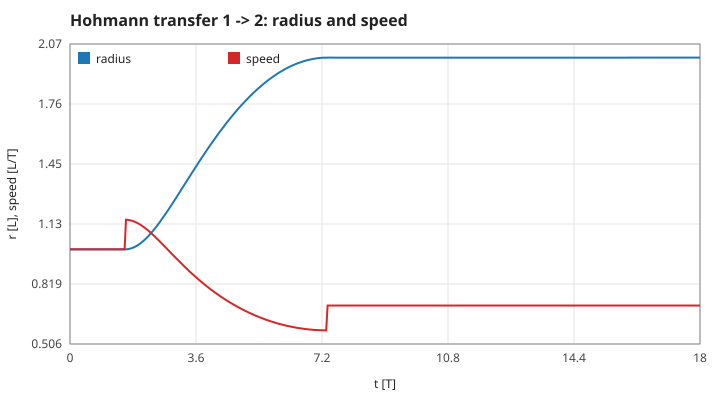
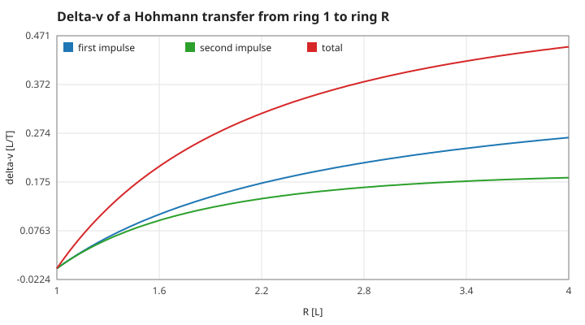
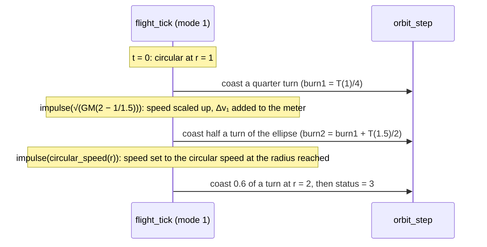
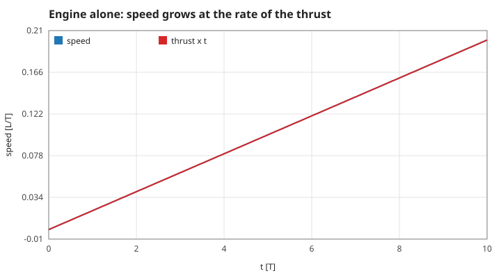
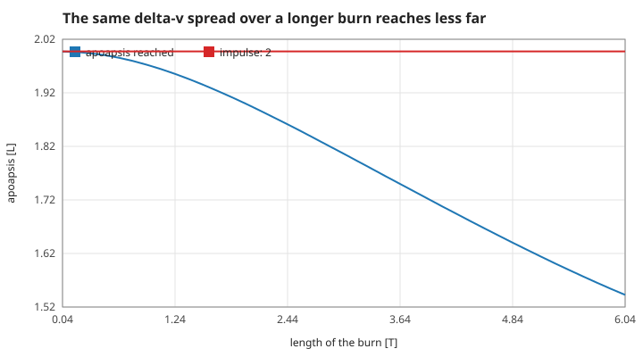
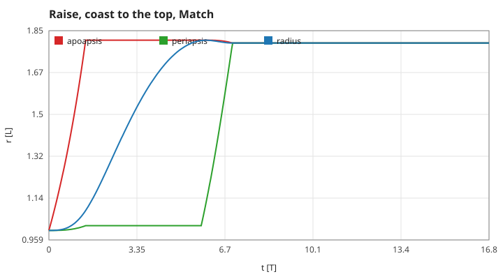
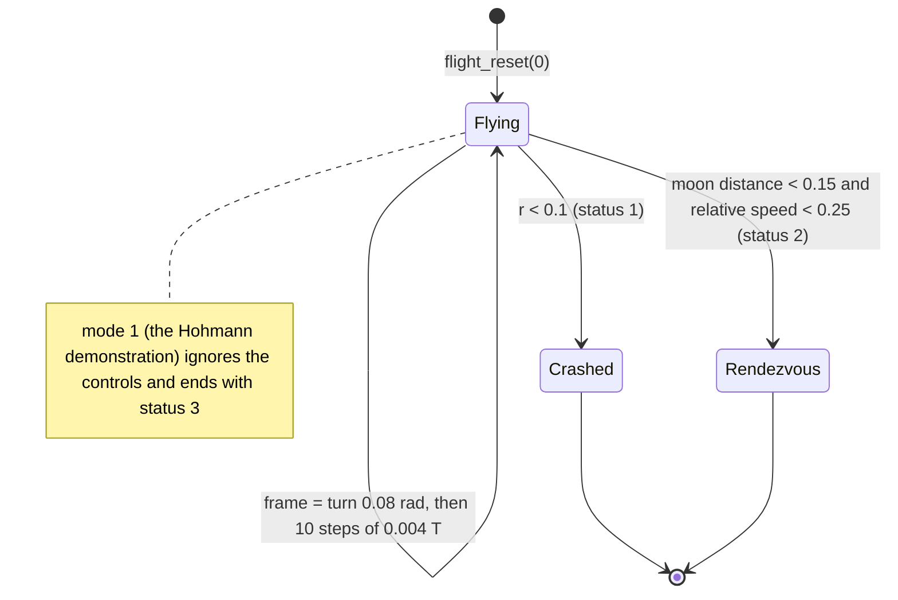

# 2. Transfers and burns

How an orbit is changed on purpose. Units as in page 1 ($GM = 1$). Measured numbers are quoted by their id in [figures/values.md](figures/values.md).

[Back to the index](README.md)

## S08 — The Hohmann transfer

**Statement.** To go from a circular orbit of radius $r_1$ to a coplanar one of radius $r_2$ with two impulses along the direction of motion, use the ellipse that touches both circles, $a_t = \tfrac12(r_1 + r_2)$ [Hohmann 1925; Curtis 2020, §6.3]:

$$\Delta v_1 = \sqrt{GM\left(\frac{2}{r_1} - \frac{1}{a_t}\right)} - \sqrt{\frac{GM}{r_1}}, \qquad \Delta v_2 = \sqrt{\frac{GM}{r_2}} - \sqrt{GM\left(\frac{2}{r_2} - \frac{1}{a_t}\right)},$$

and the coast between them lasts half the period of the ellipse, $t_t = \pi\sqrt{a_t^3 / GM}$. For $r_1 = 1$, $r_2 = 2$: $\Delta v_1 = \sqrt{4/3} - 1 = 0.154701$, $\Delta v_2 = \sqrt{1/2} - \sqrt{1/3} = 0.129757$, $t_t = \pi\,1.5^{1.5} = 5.771$ T.

**Assumptions and where they break.** Impulsive burns (S09 shows what a long burn costs), star only, coplanar circular orbits. Among two-impulse transfers it is the cheapest for $r_2 / r_1 < 11.94$ [Curtis 2020, §6.4]; the program never exceeds a ratio of 2.6.

**Derivation.** An impulse changes the speed but not the position. Each formula is the vis-viva speed (S03) on the ellipse at the touching point minus the circular speed there (S02); the transfer time is Kepler's third law (S02) for the ellipse, halved.

**Code.** `flight_reset(1)` and `flight_tick` in `src/flight.c`; the static helper `impulse` rescales the velocity vector to the target speed and adds $|\Delta v|$ to `FLIGHT_DV`. The second impulse asks for the circular speed at the radius actually reached, so a small arrival error does not leave an eccentric orbit. `headless` in `src/main.c` writes the same transfer to `docs/run.csv`.

**Tests.** `test_hohmann_transfer_reaches_the_target_radius` in `tests/test_orbit.c`: after half the ellipse's period the radius is within 0.01 of 2. `transfer_bench` in `tests/test_flight.c`: $|\Delta v_1 - (\sqrt{4/3} - 1)| < 1\times10^{-5}$, radius at the second burn within 0.002 of 2, and the final circle's radius varies by less than 0.002. Measured: `hohmann-dv1`, `hohmann-dv2`, `hohmann-dv-total` = 0.284466, `hohmann-arrival-radius`, `hohmann-final-radius`, and the coast `hohmann-coast` = 5.76 T, which is the formula rounded to the 0.04 T frame.

## S09 — Thrust: what a burn does, and why short burns are worth more

**Statement.** While the engine burns, the ship gets an extra acceleration of fixed size $a_T$ along its heading $\theta$:

$$\mathbf a = \mathbf a_{grav} + b\,a_T(\cos\theta, \sin\theta), \qquad 0 \le b \le 1 .$$

In empty space the speed gained is $\Delta v = a_T\,t$; that product is what the manual mode's meter and the Ice Run's tank count. Near the star a burn of the same $\Delta v$ changes the orbit less the longer it is spread out (gravity loss) [Curtis 2020, §6.2; Sutton & Biblarz 2017, §4.2].

**Assumptions and where they break.** Constant acceleration, no mass change (the ship does not get lighter as it burns), instant throttle. $a_T$ is 0.02 in the manual mode and 0.10 in the Ice Run.

**Derivation.** With gravity off, $\dot{\mathbf v} = a_T\hat{\mathbf u}$ integrates to $a_T t$. With gravity on, the work done per unit of $\Delta v$ is $\mathbf v\cdot\hat{\mathbf u}$, largest at periapsis where the ship is fastest (the Oberth effect); a long burn leaves the periapsis and climbs, so later thrust acts at lower speed and partly along the radius.

**Code.** `orbit_step` in `src/orbit.c` adds `burn * w->thrust * cos(heading)` and `sin(heading)` to both half kicks. `flight_tick` adds `world.thrust * 0.004` to the meter per step burnt; `voyage_tick` subtracts `burn * thrust * V_DT` from the tank (S17).

**Tests.** `test_thrust_adds_speed`: a prograde burn must raise the energy above the coasting ship's. `manual_matches_existing_integrator` in `tests/test_flight.c` checks the meter reads 0.024 after 30 burning frames. Measured: `thrust-dv` and `thrust-direction` (exact to rounding), `manual-dv-meter`; delivered in 0.04 T the Hohmann impulse lifts the apoapsis to `finite-burn-apoapsis-fast`, at the tug's thrust (1.54 T) to `finite-burn-apoapsis-tug`, and spread over 6 T only to `finite-burn-apoapsis-slow`.

## S10 — Raise, Lower, Match: how the three commands move the apsides

**Statement.** The Ice Run's tug points itself; the pilot only chooses a command.

| command | thrust direction | effect on the orbit |
|---|---|---|
| Raise | along the velocity (prograde) | $E$ grows; the far side of the orbit moves out |
| Lower | against the velocity (retrograde) | $E$ falls; the far side moves in |
| Match | along $\mathbf v_c - \mathbf v$, where $\mathbf v_c$ is the circular velocity at the present radius, in the present sense of rotation | drives the eccentricity to 0 at this radius |

A short tangential burn at an apsis leaves that apsis where it is and moves the opposite one; this is why a transfer is "Raise, coast half a turn, Match" [Curtis 2020, §6.2].

**Assumptions and where they break.** The "opposite apsis" rule is exact only for an impulse. The tug's burn from ring 1 to an apoapsis of 1.8 lasts 1.4 T, about a fifth of a turn, and lifts the periapsis from 1 to `raise-periapsis` = 1.02. Match throttles down as the error shrinks (`burn = min(1, need / (thrust * dt))`) so it ends exactly, not in a limit cycle.

**Derivation.** $dE = \mathbf v\cdot d\mathbf v$ is largest for $d\mathbf v \parallel \mathbf v$, and $a = -GM/(2E)$. At an apsis a tangential impulse keeps the velocity perpendicular to the radius, so the point remains an apsis of the new orbit. For Match: when $\mathbf v = \mathbf v_c$ exactly, $E = -GM/(2r)$ and $h = r v_c$, which gives $e = 0$ in S05.

**Code.** `voyage_tick` in `src/voyage.c`: Raise burns along `atan2(vy, vx)`, Lower adds $\pi$, Match takes its direction and size from the static helper `match_vector`. `VV_MATCH_ERROR` is $|\mathbf v_c - \mathbf v|$, the delta-v still needed.

**Tests.** `tests/test_voyage.c` flies whole runs with these commands (`[mech] route` checks the rings they must reach). Measured: `raise-cost` = 0.140 against 0.134 for an impulse, `match-eccentricity` = 0, `match-error-left` = 1.4e-9, `match-radius`.

## S11 — Manual mode: rendezvous, crash and the relative speed

**Statement.** The manual flight ends in one of two ways, checked after every 0.004 T step:

- **crash**: $r < 0.1$;
- **rendezvous**: distance to the moon below 0.15 **and** speed relative to the moon below 0.25.

The moon's velocity is $\boldsymbol\omega_m \times \mathbf r_m = \omega_m(-y_m, x_m)$, so the relative speed is $|(v_x + \omega_m y_m,\ v_y - \omega_m x_m)|$.

**Assumptions and where they break.** The moon has no size and no surface; "rendezvous" is a region in position and velocity, not a docking. The thresholds are game rules, not physics.

**Derivation.** Differentiate S07's $\mathbf r_m(t)$: $\dot{\mathbf r}_m = r_m\omega_m(-\sin\omega_m t, \cos\omega_m t) = \omega_m(-y_m, x_m)$, and subtract from the ship's velocity. At $t = 0$ the ship moves at $(0, 1)$ and the moon at $(0, 3\omega_m) = (0, 0.577)$: a relative speed of $1 - \sqrt{1/3} = 0.4226$, so a pilot must both climb to the moon's ring and shed that difference.

**Code.** `flight_tick` and `flight_value` (`FLIGHT_MOON_DISTANCE`, `FLIGHT_REL_SPEED`, `FLIGHT_STATUS`) in `src/flight.c`.

**Tests.** `manual_matches_existing_integrator` in `tests/test_flight.c` checks the controller's state against `orbit_step` called directly, to 1e-12, for 100 frames of turning and burning; the two end conditions are exercised by the browser smoke test (`scripts/smoke.cjs`), not by a unit test. Measured: `rel-speed-start` = 0.42265 and `moon-distance-start` = 2 at $t = 0$.

## References

- W. Hohmann, *Die Erreichbarkeit der Himmelskörper*, Oldenbourg, 1925.
- H. D. Curtis, *Orbital Mechanics for Engineering Students*, 4th ed., Butterworth-Heinemann, 2020.
- G. P. Sutton, O. Biblarz, *Rocket Propulsion Elements*, 9th ed., Wiley, 2017.
