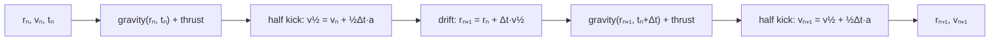
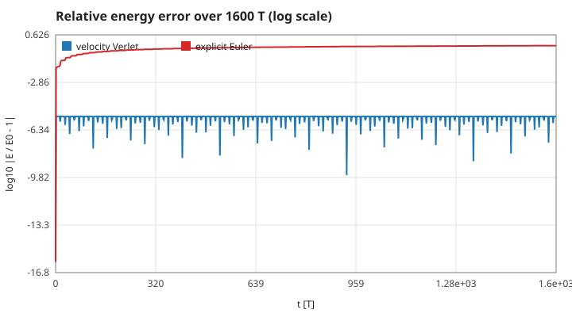
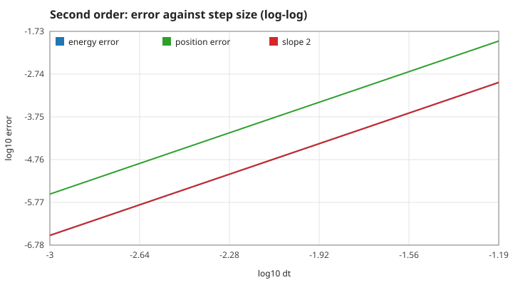
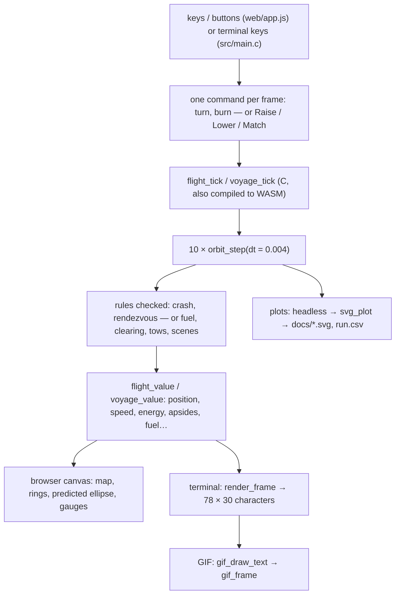

# 3. The integrator, the frame and the screen

How the equations of page 1 are advanced in time, how good the result is, and how a key press reaches the picture. Measured numbers are quoted by their id in [figures/values.md](figures/values.md).

[Back to the index](README.md)

## S12 — The velocity Verlet step

**Statement.** One step of length $\Delta t$ takes position and velocity $(\mathbf r_n, \mathbf v_n)$ at time $t_n$ to

$$\mathbf v_{n+1/2} = \mathbf v_n + \tfrac12\Delta t\,\mathbf a(\mathbf r_n, t_n), \qquad \mathbf r_{n+1} = \mathbf r_n + \Delta t\,\mathbf v_{n+1/2}, \qquad \mathbf v_{n+1} = \mathbf v_{n+1/2} + \tfrac12\Delta t\,\mathbf a(\mathbf r_{n+1}, t_n + \Delta t),$$

where $\mathbf a$ is gravity (S01) plus the thrust (S09), the thrust being held constant over the step [Swope et al. 1982; Hairer, Lubich & Wanner 2003, §1]. This is the "kick–drift–kick" form of the Störmer–Verlet (leapfrog) method.

**Assumptions and where they break.** The acceleration depends on position and time only, never on velocity, so the two half kicks need no iteration. The heading used for the thrust is the one at the start of the step; when the tug "points itself" (S10) the direction is refreshed every step, which is a first-order treatment of the thrust direction (it does not matter for gravity).

**Derivation.** Split the motion into "velocity changes, position frozen" (a kick) and "position changes, velocity frozen" (a drift). Each can be solved exactly; composing half a kick, a full drift and half a kick is symmetric in time, which is what gives second order (S14) and the conservation properties (S13).

**Code.** `orbit_step` in `src/orbit.c`, eleven lines: `hx = s->vx + 0.5 * dt * ax`, `s->x += dt * hx`, a second call of `gravity` at `t + dt`, `s->vx = hx + 0.5 * dt * (ax + bx)`. It is the only place where the ship's state advances; the terminal game, the GIF, the browser and the Ice Run all call it.

**Tests.** `manual_matches_existing_integrator` in `tests/test_flight.c` pins the browser's controller to this function to 1e-12. Measured: one step with the moon and half throttle equals the three formulas written out separately, to the last bit (`verlet-one-step` = 0).

## S13 — Why the energy error stays bounded

**Statement.** The velocity Verlet map is (a) **time-reversible** — stepping forward, reversing the velocity and stepping again returns to the start — and (b) **symplectic** — it preserves phase-space area. A symplectic method of order 2 applied to a Hamiltonian system conserves a nearby "modified" energy $\tilde H = H + O(\Delta t^2)$ over exponentially long times, so the error in the true energy **oscillates with an amplitude $O(\Delta t^2)$ and does not grow** [Hairer, Lubich & Wanner 2006, ch. IX, Theorem 8.1; Leimkuhler & Reich 2004, ch. 5]. It also conserves the angular momentum exactly (S04).

**Assumptions and where they break.** A fixed step and a time-independent, smooth force: the star-only modes. Thrust and the moon make the system non-autonomous, and the statement then applies to the stretches between burns. Very close passes ($r$ comparable to the distance moved in one step) break the "nearby" in "nearby energy"; the crash radius 0.1 and the tow radius 0.35 keep the ship out of them.

**Derivation.** (A sketch.) A kick $(\mathbf r, \mathbf v) \mapsto (\mathbf r, \mathbf v + c\,\mathbf a(\mathbf r))$ and a drift $(\mathbf r, \mathbf v) \mapsto (\mathbf r + c\,\mathbf v, \mathbf v)$ are shears; each has Jacobian determinant 1 and is the exact flow of a Hamiltonian ($V$ alone, $T$ alone), hence symplectic, and a composition of symplectic maps is symplectic. The half–full–half arrangement reads the same backwards, which gives reversibility. Backward error analysis then builds $\tilde H$ as a series in $\Delta t^2$. Explicit Euler is neither symplectic nor reversible: its energy error grows steadily.

**Code.** `orbit_step` in `src/orbit.c`. (Explicit Euler appears only in `tests/theory_figs.c`, as the contrast.)

**Tests.** `test_energy_and_momentum_drift_are_tiny` in `tests/test_orbit.c`: relative energy error below 0.001 over 200 T and $|h - h_0| < 1\times10^{-9}$. Measured at the program's step 0.004: the largest error in the first 160 T is `verlet-energy-early` = 4.5e-6, and over the following 1440 T it is the same number to 2 parts in 100 million (`verlet-energy-late`); explicit Euler ends at `euler-energy-end` = 0.69, off the orbit. Reversal: 2500 steps forward, flip, 2500 steps more return to the start within `verlet-reversal` = 1.3e-16.

## S14 — Second-order accuracy

**Statement.** Over a fixed time span the error of the velocity Verlet solution — in position, and in the oscillation of the energy — is proportional to $\Delta t^2$: halving the step divides it by four [Hairer, Lubich & Wanner 2003, Theorem 1.2].

**Assumptions and where they break.** A smooth force and a span short enough that the phase error (which grows linearly in time, with a coefficient $\propto \Delta t^2$) is still small. The energy must be the one the force actually conserves: `gravity` softens the force, so the matching potential is $-GM/\sqrt{r^2 + \epsilon}$. Measured with the unsoftened `ship_energy`, a part of the error that does not depend on the step remains (`softening-floor` = 6.2e-6 against 4.5e-6 at the same step), and the apparent order drops below 2.

**Derivation.** A symmetric one-step method has an error expansion in even powers of $\Delta t$ only; the method is consistent (order at least 1), so its order is at least 2. The local error is $O(\Delta t^3)$ per step and there are $O(1/\Delta t)$ steps.

**Code.** `orbit_step` in `src/orbit.c`. The program always uses $\Delta t = 0.004$ T (`flight_tick`, `V_DT` in `src/voyage.c`); the terminal game and the plots use 0.002.

**Tests.** The unit tests bound the error at one step size; the order itself is measured by `make theory-figs` over seven step sizes from 0.064 to 0.001 on the ellipse of page 1: `verlet-order-energy` = 2.00001 and `verlet-order-position` = 2.0007. At the program's step the position is 4.3e-5 L from a run sixteen times finer after 8 T (`verlet-position-dt0.004`), and the softened energy oscillates by `verlet-energy-dt0.004`.

## S15 — Frames: from a key press to the picture

**Statement.** Every mode advances in **frames of ten steps of 0.004 T** (0.04 T per frame). The controls are read once per frame; all numbers on the screen are read back from the C state after the frame. JavaScript and the terminal renderer draw and collect input only — no physics is computed outside C.

**Assumptions and where they break.** The frame rate of the display does not enter the physics: a slow display runs the same steps later, never larger steps. `flight_tick` and `voyage_tick` clamp one call to 250 frames.

**Derivation.** This is a design rule, not a theorem; it follows from S13 (a fixed step is what keeps the energy bounded) and it is what makes every run reproducible bit for bit, which the story bench relies on.

**Code.** `flight_tick` in `src/flight.c`, `voyage_tick` in `src/voyage.c`, the exported wrappers in `src/voyage_web.c`; `render_frame` in `src/render.c` (1 row = 0.2 L, 1 column = 0.1 L); `gif_open`, `gif_frame`, `gif_close`, `gif_text_size`, `gif_draw_text` in `src/gif.c`; `svg_plot` in `src/svg.c`.

**Tests.** `tests/test_voyage.c` asserts that every frame advances the mission clock by exactly 0.04 T (`no flat waits`); `test_render_fits_the_screen` in `tests/test_orbit.c` checks the character map; `tests/test_gif.c` round-trips the GIF encoder. Measured: `frame-time` = 0.04.

## References

- W. C. Swope, H. C. Andersen, P. H. Berens, K. R. Wilson, "A computer simulation method for the calculation of equilibrium constants for the formation of physical clusters of molecules", *J. Chem. Phys.* 76, 637 (1982) — the velocity form of Verlet's method.
- L. Verlet, "Computer 'experiments' on classical fluids. I", *Phys. Rev.* 159, 98 (1967).
- E. Hairer, C. Lubich, G. Wanner, "Geometric numerical integration illustrated by the Störmer–Verlet method", *Acta Numerica* 12, 399–450 (2003).
- E. Hairer, C. Lubich, G. Wanner, *Geometric Numerical Integration*, 2nd ed., Springer, 2006.
- B. Leimkuhler, S. Reich, *Simulating Hamiltonian Dynamics*, Cambridge University Press, 2004.
