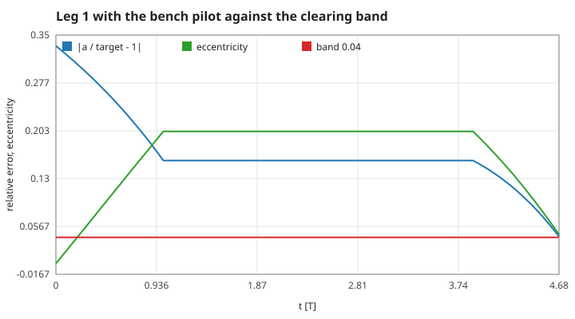
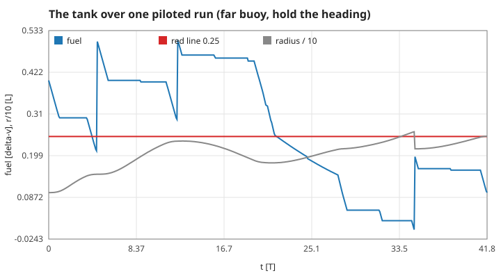
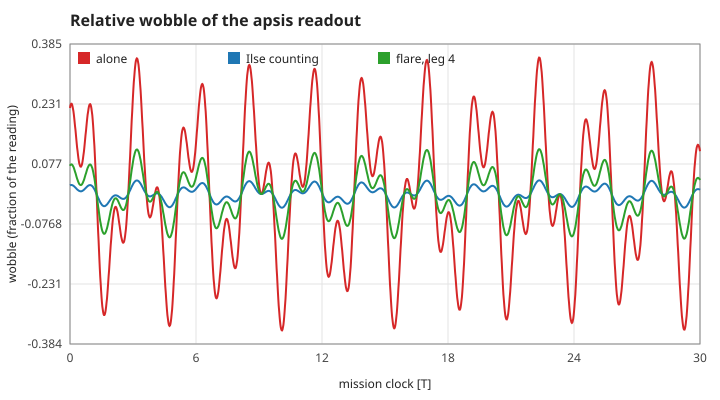
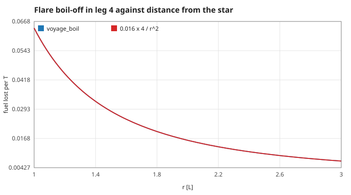
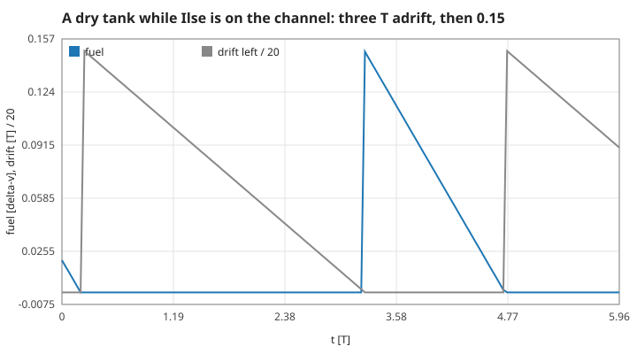
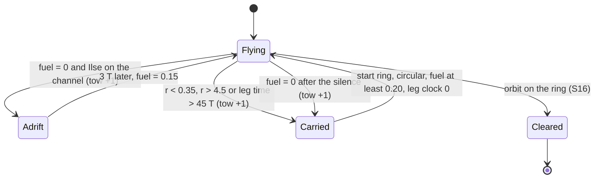
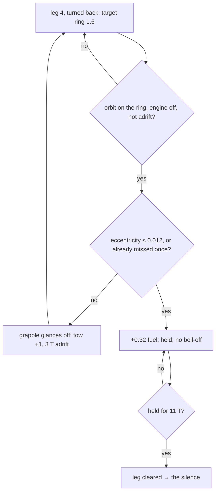
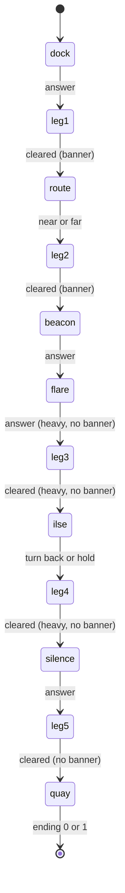

# 4. The Ice Run: the rules of the game layer

`src/voyage.c` puts a game on top of the unchanged integrator: five transfers between circular orbits, flown with Raise / Lower / Match (S10), star only. These are rules, not laws of nature; each is stated with its constants so that the code can be checked against it. Measured numbers are quoted by their id in [figures/values.md](figures/values.md).

[Back to the index](README.md)

## S16 — Legs, target rings and when a leg is cleared

**Statement.** The run is five legs. Each has a target ring of radius $r_t$:

| leg | from | target ring |
|---|---|---|
| 1 | 1.0 | 1.5 |
| 2 | 1.5 | 1.9 (near buoy) or 2.4 (far buoy); 2.2 when the route effect is off |
| 3 | the buoy | 1.8 |
| 4 | 1.8 | 2.2, or 1.6 (Ilse's pod) after turning back |
| 5 | leg 4's ring | 2.6 (Lamp Quay) |

A leg is **cleared** at the end of the first frame in which the orbit — not the position — is on the ring:

$$\left|\frac{a}{r_t} - 1\right| < 0.04 \quad\text{and}\quad e < 0.04,$$

with $a$ and $e$ from S05.

**Assumptions and where they break.** Judging the orbit means the tug may be anywhere on it; a nearly circular orbit of the right size is "there". The pod's leg adds a wait (S21). The check runs once per frame, so a leg can clear up to 0.04 T after the condition first holds.

**Derivation.** A design rule. The band is wide enough for a pilot working from a wobbling gauge (S18) and tight enough that the next transfer starts from a known ring: with both at the limit, the radius stays within about 8 % of the target.

**Code.** `TARGET`, `CLEAR_A`, `CLEAR_E`, `start_leg` and the `on_ring` test in `voyage_tick`, `src/voyage.c`.

**Tests.** `tests/test_voyage.c`: `[mech] dock` asserts the first target is 1.5 from ring 1.0; `[mech] route` asserts the rings 1.9, 2.4 and 2.2. Measured on one piloted leg: cleared with `clear-a-error` = 0.033 and `clear-ecc` = 0.035, after `leg1-time` = 4.72 T (half the transfer ellipse's period is 4.39 T).

## S17 — Fuel is delta-v

**Statement.** The tank is measured in units of speed. Each 0.004 T step it loses

$$\Delta(\text{fuel}) = -\,b\,a_T\,\Delta t - \dot m_{boil}\,\Delta t, \qquad a_T = 0.10,$$

where $b$ is the throttle of S09 (never more than the tank allows) and $\dot m_{boil}$ is the flare's boil-off (S19). The tank starts at 0.30, or 0.40 when Ilse fills it; below 0.25 the gauge is red; at 0 the engine stops and a tow follows (S20).

**Assumptions and where they break.** "Fuel = delta-v" ignores that a real rocket's delta-v depends on the logarithm of its mass ratio (Tsiolkovsky); here the tug's mass never changes (S09), so the two are proportional and the tank can simply be counted in L/T.

**Derivation.** With constant acceleration $a_T$ the speed available from burning for a time $t$ is $a_T t$ (S09). The cheapest way to change rings costs the two Hohmann impulses of S08, so the tank can be compared with the route directly: leg 1 (1.0 to 1.5) costs 0.1816 for impulses.

**Code.** `TANK`, `DOCK_TANK`, `RED_LINE`, `V_THRUST` and the fuel line of `voyage_tick` in `src/voyage.c`; additions in `voyage_answer` (dock, far-buoy bonus 0.30, cache 0.22) and at the pod (0.32).

**Tests.** `[mech] dock` (0.30 to 0.40), `[mech] route` (+0.30 only on the far route), `[mech] beacon` (+0.22) in `tests/test_voyage.c`. Measured: two frames of Raise cost exactly `fuel-per-burn` = 0.008; the bench pilot flew leg 1 on `leg1-fuel-used` = 0.184 against 0.1816 for ideal impulses; `tank-start`, `tank-dock`.

## S18 — The wobbling readout and Ilse's count

**Statement.** The apoapsis and periapsis **shown to the pilot** are the true ones (S05) times $1 \pm w(t)$:

$$w(t) = A\,\big[\,0.6\sin(2.3\,t + 0.4) + 0.4\sin(5.9\,t + 1.7)\,\big],$$

with $t$ the mission clock and the amplitude

$$A = 0.35 \times (0.10 \text{ while Ilse calls the burns}) + (0.08 \text{ in leg 4 under the flare}).$$

While her channel is open Ilse also gives two cues computed from the **true** orbit: "cut" when a Raise has put the apoapsis on the ring (or a Lower the periapsis), and "now" when the coasting tug is within 2 % of the ring's radius on an orbit that is not yet circular.

**Assumptions and where they break.** The wobble is deterministic — the same for every run at the same clock time — so there is no random number in the game. It affects only what is displayed; the clearing rule (S16) uses the true elements. $|w| \le A$ because the two sines' weights add to 1.

**Derivation.** A design rule. Two incommensurate frequencies make a signal that does not visibly repeat within a leg; scaling by 0.10 is what "someone is calling the burns" is worth, and removing it for the last leg is the story's cost (S22).

**Code.** `voyage_wobble` and `voyage_cue` in `src/voyage.c`; `VV_APO_READ`, `VV_PERI_READ`, `VV_WOBBLE`, `VV_CUE`, `VV_COUNT_ON` in `voyage_value`. Constants `BASE_WOBBLE`, `COUNT_WOBBLE`, `FLARE_WOBBLE`.

**Tests.** `[mech] dock` asserts the wobble with the count is 0.10 of the wobble without; `[mech] flare` asserts the wilder readout in leg 4. Measured: `wobble-alone`, `wobble-count`, `wobble-flare`, `wobble-count-ratio` = 0.1, and the readouts are exactly true × (1 ± w) (`apo-readout`, `peri-readout`); the cue is silent before the apoapsis reaches the ring and says "cut" after (`cue-cut`, `cue-cut-now`).

## S19 — The flare: boil-off that falls with the square of the distance

**Statement.** In leg 4, with the flare effect on and the tug not grappled to the pod, fuel boils off at

$$\dot m_{boil}(r) = 0.016 \times \frac{4}{r^2}\ \text{per T},$$

burning or not: 0.016 per T at $r = 2$, 0.025 per T on the pod's ring at 1.6.

**Assumptions and where they break.** Only leg 4; nothing in the other legs, and nothing while the tug sits in the pod's shadow (`held > 0`). The $1/r^2$ form is the flux of light from a point source [e.g. Rybicki & Lightman 1979, §1.1], used here as a game rule.

**Derivation.** Radiant flux through a sphere of radius $r$ is the luminosity over $4\pi r^2$; a tank absorbing a fixed fraction boils in proportion. The consequence for play: going down to the pod is hotter, and waiting costs fuel — over a leg of about 10 T at $r \approx 2$ the flare takes about 0.16, more than half the starting tank.

**Code.** `voyage_boil` in `src/voyage.c` (`FLARE_BOIL`), subtracted every step in `voyage_tick`; `VV_BOIL`.

**Tests.** `[mech] flare` in `tests/test_voyage.c`; `[mech] beacon` shows in the bench that without the cache the flare boils more tanks dry. Measured: `boil-r2`, `boil-r1.6`, `boil-grappled` = 0, `boil-other-leg` = 0, and coasting 1 T on the ring $r = 2$ loses `boil-per-T` = 0.016.

## S20 — Tows: what happens when a leg fails

**Statement.** A tow is a counted failure. There are two kinds.

| trigger | while Ilse is on the channel | after the silence |
|---|---|---|
| tank at 0 | her drone refuels in place: the tug drifts with a dead engine for 3 T, then the tank is 0.15 | Lamp Quay's tug **carries** the tug back |
| $r < 0.35$, $r > 4.5$, or 45 T on one leg | carried back | carried back |

**Carried back** means: placed on the leg's starting ring at the same angle, on a circular orbit, the leg's clock reset, and the tank raised to 0.20 if it was lower.

**Assumptions and where they break.** The carry teleports the tug (it is the one place where the state does not come from `orbit_step`); the mission clock is not rewound, so every failure costs time. With the silence effect off, the drone keeps coming in the last leg.

**Derivation.** Design rules. The drone's 0.15 is less than one transfer's cost (S17), so a dry tank usually leads to another; the carry after the silence loses the whole leg — the story's raised stakes.

**Code.** `tow` (static) and the last lines of the frame loop in `voyage_tick`, `src/voyage.c`; constants `TOW_FUEL`, `DRONE_WAIT`, `CARRY_FUEL`, `LEG_LIMIT`, `SCORCH_R`, `LOST_R`; `VV_TOWS`, `VV_DRIFT`.

**Tests.** `[mech] silence` in `tests/test_voyage.c`: after the silence a dry tank means being dragged back to the start of the leg. Measured: `drone-wait` = 3, `drone-fuel`, `tows-counted` = 1; after the silence `carry-tows` = 1, `carry-radius` = 2.2, `carry-fuel` = 0.2, `carry-ecc` = 0; `scorch-tow`, `lost-tow`, and a tug that only coasts is fetched after `limit-tow` = 45.04 T.

## S21 — Ilse's pod: a grapple that needs a quiet orbit

**Statement.** After choosing to turn back, leg 4's ring is the pod's, $r_t = 1.6$, and clearing it takes more than S16:

1. the orbit is on the ring (S16), the engine is **off** (Coast) and the tug is not adrift;
2. if the eccentricity is above 0.012 the grapple glances off — once per leg: a counted failure and 3 T adrift; the second pass always holds;
3. when it holds, 0.32 of fuel comes aboard at once and the tug must stay for 11 T while it is pumped; the flare does not boil the tank during the wait (S19); then the leg is cleared.

**Assumptions and where they break.** The pod has no position: "on its ring with the engine off" is the whole rendezvous. The 11 T are flown, not skipped — the clock and the orbit keep running.

**Derivation.** Design rules: the threshold 0.012 is less than a third of the ordinary 0.04, so Match must be held to the end; 11 T at the leg's boil-off rate would cost about 0.28, which is why the wait is shadowed.

**Code.** `voyage_hold_need` and the `held` / `missed` branches of `voyage_tick` in `src/voyage.c`; constants `POD_R`, `POD_FUEL`, `POD_SOFT`, `POD_HOLD`; `VV_HELD`, `VV_HOLD_NEED`.

**Tests.** `[mech] ilse` in `tests/test_voyage.c` covers both paths: the ring 1.6, +0.32 on a quiet grapple, the 11 T wait, and the glancing grapple as a failure. Measured in a whole piloted run: `pod-fuel` = 0.319 (0.32 less that frame's boil-off), `pod-wait` = 10.96 T after the first held frame, `hold-need-ordinary` = 0 on other legs.

## S22 — Scenes, choices and endings

**Statement.** Seven scenes open at fixed points of progress, in this order, and nothing flies while one is open:

| scene | opens | options | what it changes |
|---|---|---|---|
| dock | at the start | 1 | tank 0.30 → 0.40; Ilse's count on (S18) |
| route | leg 1 cleared | 2 | near buoy (ring 1.9) or far buoy (ring 2.4 and +0.30 fuel) |
| beacon | leg 2 cleared | 1 | +0.22 fuel from the cache |
| flare | right after the beacon | 1 | leg 4 boils (S19) and wobbles more (S18) |
| ilse | leg 3 cleared | 2 | turn back (leg 4 goes to the pod, S21) or hold the heading (ring 2.2) |
| silence | leg 4 cleared | 1 | the count is gone; a dry tank now means a carry (S20) |
| quay | leg 5 cleared | 1 | the ending: 0 = turned back, 1 = held the heading |

The flare, Ilse's call and the silence are **heavy** scenes: they are shown with no "leg cleared" banner before or after. Each effect is one bit of `effects`, so the bench can remove them one at a time.

**Assumptions and where they break.** The order is fixed by progress, not by time or chance. With an effect's bit off its scene still opens, but changes nothing.

**Derivation.** Design rules; the measured consequences of each effect and of each choice are in `docs/narrative/ablation.json` and `tension.json`, written by `make story`.

**Code.** `voyage_init`, `voyage_answer`, `voyage_options`, `voyage_heavy`, `voyage_ending`, and the static helpers `open_scene`, `clear_leg`, `raise_banner` in `src/voyage.c`; the bits `VE_DOCK` … `VE_SILENCE` in `src/voyage.h`.

**Tests.** `tests/test_voyage.c` asserts the order of the seven scenes for 12 seeds, `[quiet] flare`, `[quiet] ilse` and `[quiet] silence` (no banner), and `[choice]` (each path of each choice wins one measured outcome). Measured: `scenes-shown` = 7, `scene-first` = 0, `heavy-scenes` = 3, `choice-scenes` = 2, `ending-before` = −1; the same pilot reaches Lamp Quay in `run-time-turn-back` = 47.0 T after turning back and `run-time-hold` = 41.9 T holding the heading (one run each; the distributions are in the bench files).

## References

- G. B. Rybicki, A. P. Lightman, *Radiative Processes in Astrophysics*, Wiley, 1979 — the inverse-square law of flux.
- K. E. Tsiolkovsky, "Исследование мировых пространств реактивными приборами", 1903 — the rocket equation that the constant-mass tank deliberately leaves out.
- The rules themselves are this repository's: `src/voyage.c`, `docs/design.md`.
