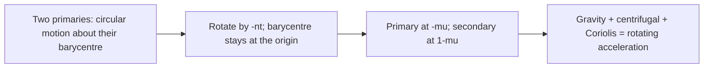
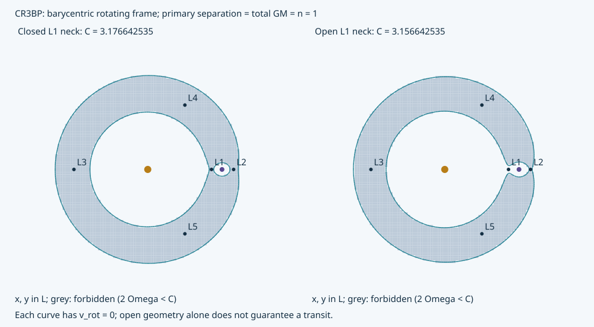
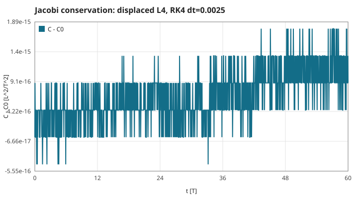
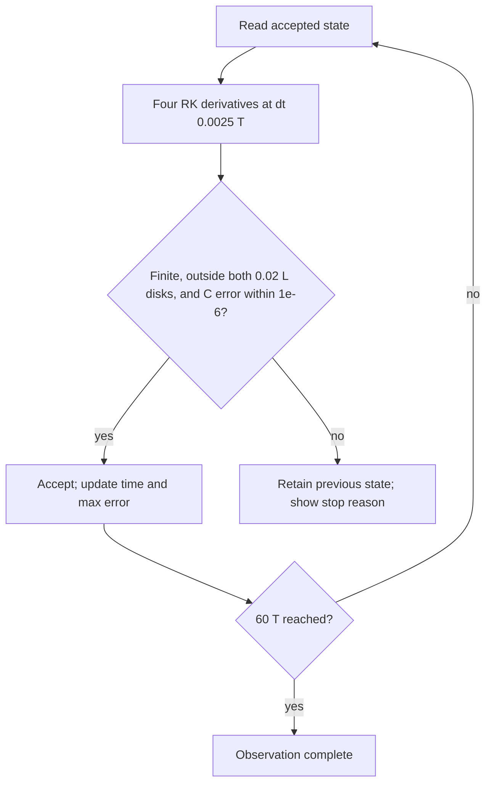
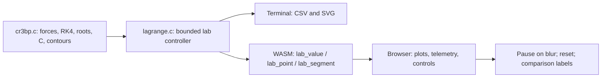

# The circular restricted three-body laboratory

This experiment is separate from the fixed-star model in [page 1](01-gravity-and-orbits.md).
Here **both** primaries orbit their barycentre. The old flight, story, CSV and GIF retain their original model.
Run `make lagrange-plots` to reproduce the CSV tables and SVG figures on this page, or open the browser's **Explore Lagrange points** link.

## S23 — Barycentric units and the rotating equations

**Statement.** Choose primary separation $a=1$ L, total gravitational parameter $G(m_1+m_2)=1$ L³/T² and hence angular frequency $n=1$ T⁻¹. With $\mu=m_2/(m_1+m_2)$, the primaries sit at $(-\mu,0)$ and $(1-\mu,0)$. Define

$$r_1^2=(x+\mu)^2+y^2,\quad r_2^2=(x-1+\mu)^2+y^2,$$
$$\Omega=\tfrac12(x^2+y^2)+\frac{1-\mu}{r_1}+\frac{\mu}{r_2},\qquad
\ddot x=\Omega_x+2\dot y,\quad \ddot y=\Omega_y-2\dot x.$$

Coordinates are L; rotating velocities are L/T. The lab uses $\mu=1/101$: the mass ratio is 1:100, but the separation and time unit differ from free flight.

**Assumptions and limits.** Planar circular primaries, a massless traveller, no thrust, no softening. The point masses are singular. This is not a rotation of the old fixed-star approximation: its star does not recoil and its moon frequency omits the moon's mass.

**Derivation.** Write the inertial position as $\mathbf R=Q(t)\mathbf r$. Differentiating twice gives $Q^T\ddot{\mathbf R}=\ddot{\mathbf r}+2\hat z\times\dot{\mathbf r}+\hat z\times(\hat z\times\mathbf r)$. Moving the latter terms to the force side gives the Coriolis terms and the gradient of the centrifugal potential.

**Code.** `src/cr3bp.c`: `cr3bp_mu`, `cr3bp_potential`, `cr3bp_acceleration`.

**Tests.** `test_jacobi_and_order` compares the potential's independent finite differences to force and verifies both Coriolis signs. The old `orbit.c` remains unchanged.

## S24 — Five equilibria, three scalar roots and two triangles

**Statement.** At rest in the rotating frame, $\nabla\Omega=0$. For $y=0$, solve

$$f(x)=x-\frac{(1-\mu)(x+\mu)}{|x+\mu|^3}-\frac{\mu(x-1+\mu)}{|x-1+\mu|^3}=0.$$

L1 is between the primaries; L2 is beyond the secondary; L3 is beyond the primary. L4 and L5 have $(x,y)=(1/2-\mu,\pm\sqrt3/2)$.

**Assumptions and limits.** $0<\mu\leq1/2$. Equilibrium is not the same as stable motion. The demonstration near L4 is one finite trajectory, not a proof of stability for every mass ratio. The small-mass approximation $|x_{L1,L2}-(1-\mu)|\simeq(\mu/3)^{1/3}$ is an approximation, not the 1e−6 reference.

**Derivation.** On each interval between singularities, $f'(x)=1+2(1-\mu)/|x+\mu|^3+2\mu/|x-1+\mu|^3>0$, so there is one root. Bisection keeps the root bracketed. Setting both primary distances to one gives the two equilateral solutions directly. The production solver uses bisection, while the independent reference uses long-double Newton iterations.

**Code.** `src/cr3bp.c#cr3bp_lagrange` (100 bisections); `src/lagrange.c#lab_point` exposes the same coordinates to WASM.

**Tests.** `test_equilibria`: six mass fractions, independent roots within 1e−6, zero acceleration below 1e−10, equilateral distances and $C_{L4,L5}=3-\mu+\mu^2$. [lagrange.csv](figures/lagrange.csv) records the measured positions, C and force residual.

## S25 — The Jacobi constant

**Statement.** Without thrust, $C=2\Omega-(\dot x^2+\dot y^2)$ is constant, in L²/T². It combines the rotating-frame potential with the rotating velocity; the old star-only `ship_energy` is not this invariant.

**Assumptions and limits.** Primaries are circular, there is no added force, and the trajectory avoids the singularities. Discrete integration only conserves C approximately.

**Derivation.** Differentiate: $\dot C=2\nabla\Omega\cdot\mathbf v-2\mathbf v\cdot\dot{\mathbf v}$. Substitute S23. The two Coriolis products cancel, leaving zero.

**Code.** `src/cr3bp.c#cr3bp_jacobi` uses the same potential as the force.

**Tests.** `test_jacobi_and_order` checks the maximum absolute error at **every step**, for three distinct 60 T trajectories. At dt = 0.0025 T, the worst is 9.36e−8, below 1e−6. The plotted displaced L4 run has maximum 2.22e−15. [jacobi.csv](figures/jacobi.csv) contains 1,501 samples, including rotating velocity and signed C error.

## S26 — RK4 and the observation limit

**Statement.** For state $z=(x,y,v_x,v_y)$ and S23's derivative $F$, use $k_1=F(z)$, $k_2=F(z+h k_1/2)$, $k_3=F(z+h k_2/2)$, $k_4=F(z+h k_3)$ and $z_{n+1}=z_n+h(k_1+2k_2+2k_3+k_4)/6$. This is fourth-order RK4, **not** a symplectic method.

**Assumptions and limits.** Smooth force over a step. Unlike the old position-dependent force, rotating acceleration depends on velocity, so ordinary velocity Verlet cannot be copied unchanged. Long-time energy bounds are not promised. The display advances 16 steps of 0.0025 T per frame, up to 60 T. It rejects a step if C error exceeds 1e−6, becomes nonfinite, or either primary distance is below 0.02 L; the last accepted state is retained.

**Derivation.** Taylor expansion of the four derivative evaluations cancels errors through order four. For a smooth finite interval the global error is $O(h^4)$; halving h should reduce it about sixteenfold. The code measures this independently by three step sizes rather than assuming it from the method's name.

**Code.** `src/cr3bp.c#cr3bp_step`; `src/lagrange.c#lab_tick`.

**Tests.** `test_jacobi_and_order` measures a three-resolution position-difference ratio 17.40 (expected asymptotic value 17 for coarse–fine differences, tending to 16 with an exact reference). `test_lab` checks time, reset, a real L1 crossing and the accepted-state error bound after stopping.

## S27 — Zero velocity, forbidden regions and the L1 neck

**Statement.** The speed satisfies $v^2=2\Omega-C\geq0$. Thus $2\Omega<C$ is forbidden for that C and $2\Omega=C$ is its zero-velocity curve. Let $C_1=2\Omega(L1)$. The L1 throat is closed at $C_1+0.01$ and open at $C_1-0.01$. Opening a throat is a necessary geometric permission, not a guarantee of transit.

**Assumptions and limits.** A planar contour on a finite map $[-1.7,1.7]^2$. A 128×128 grid approximates its shape; unresolved small features are not certified. Grey cell shading samples a coarser grid and is a visual approximation. Changing a comparison level resets the displayed run and **does not** change its physical C.

**Derivation.** Split every grid square along the same diagonal into two triangles; sign-changing edges intersect the level set. Refine each edge intersection with 42 bisections of the actual C potential. Joining those endpoints gives line segments without the ambiguous four-edge saddle case of marching squares. The spatial polygon error remains; tiny endpoint residual is not a claim of exact curved boundaries.

**Code.** `src/cr3bp.c#cr3bp_contours`; `src/lagrange.c#lab_allowed`, `src/lagrange.c#lab_segment`.

**Tests.** `test_contours` tests the two sides of the L1 inequality, finiteness, required-count and bounded-buffer behavior. At the default mass fraction, 1,100/1,096 segments describe the closed/open levels; their maximum endpoint residual is 7.55e−15. Both native and WASM use these C intersections.

## S28 — One calculation, two observation paths

**Statement.** The terminal's `--lagrange <directory>` writes point coordinates, trajectory samples, a Jacobi graph and two contour panels. The browser calls the same C lab API. Reset chooses a reproducible L4 displacement or a point left of L1 moving right; controls change timing and preset, not the equations.

**Assumptions and limits.** Browser plotting uses CSS pixels and system fonts; numerical values have the C model's units. The traveller/primary symbols are enlarged and not art assets. The entry page's navigation changes, while its original physics and story outputs are preserved. No persistent storage, external communication or deployment.

**Derivation.** The numerical state and contours have one C source. Native CSV and exported WASM values can therefore be compared at identical frame boundaries before testing the presentation separately.

**Code.** `src/lagrange.c#lab_reset`, `src/lagrange.c#lab_value`, `src/lagrange.c#lagrange_output`; `web/lagrange.js` draws the results.

**Tests.** `test_lab`, and local `scripts/lagrange-smoke.cjs`: native/WASM 100×13 values, real navigation, both presets, pause/reset/blur, changing boundaries, missing-engine recovery, text ≥14 CSS px and targets ≥44 CSS px in desktop and phone portrait/landscape.

## Sources

Consulted 2026-11-13; derivations and figures above are written and generated for this implementation.

- Richard Fitzpatrick, University of Texas: [circular restricted problem and units](https://farside.ph.utexas.edu/teaching/celestial/Celestialhtml/node80.html).
- Fitzpatrick: [co-rotating frame and Jacobi integral](https://farside.ph.utexas.edu/teaching/celestial/Celestial/node83.html).
- Fitzpatrick: [Lagrange points](https://farside.ph.utexas.edu/teaching/celestial/Celestial/node84.html), [zero-velocity surfaces](https://farside.ph.utexas.edu/teaching/celestial/Celestialhtml/node85.html).
