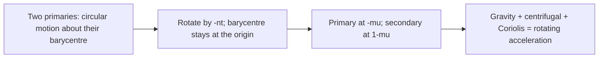
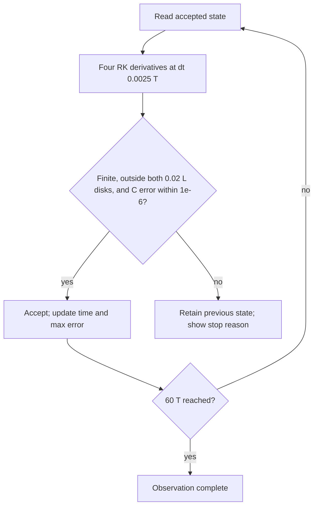
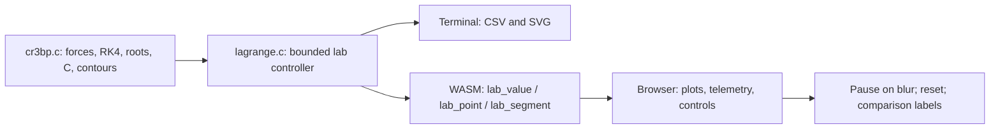
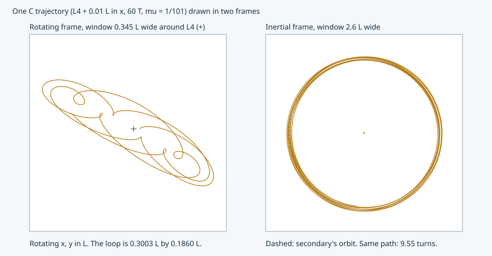
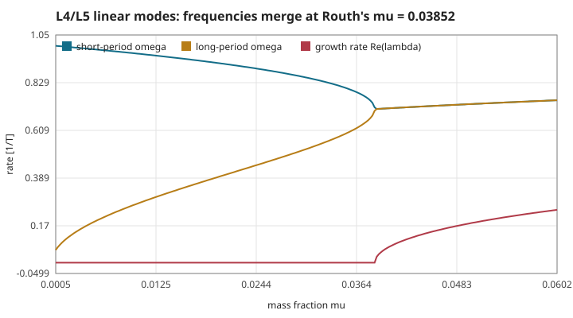
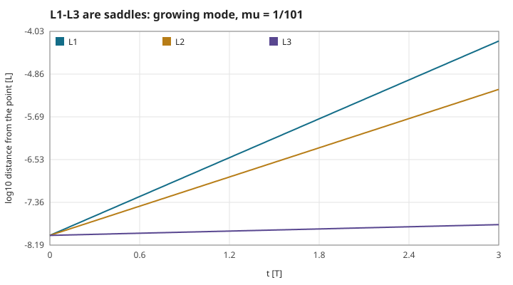
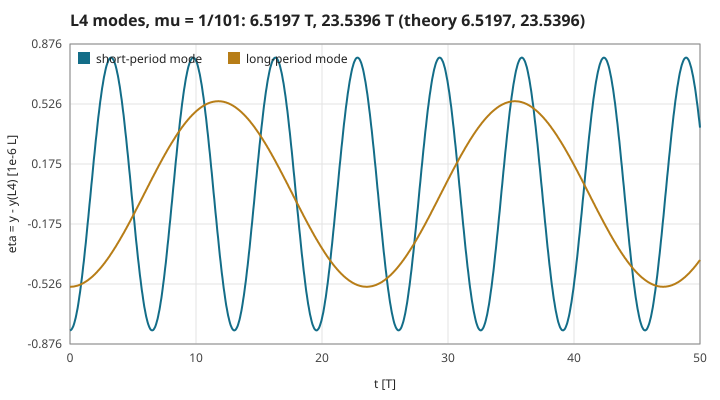
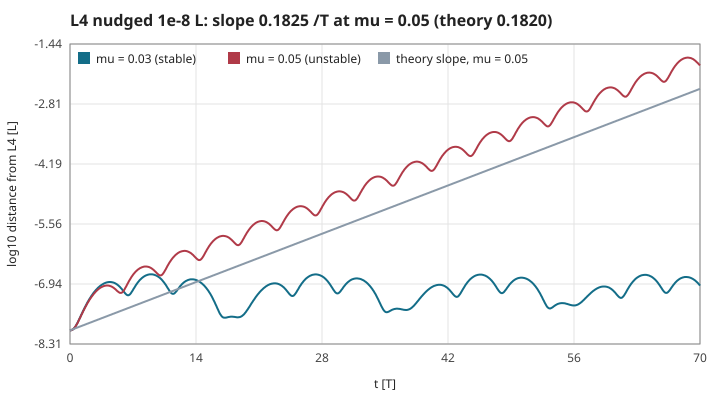
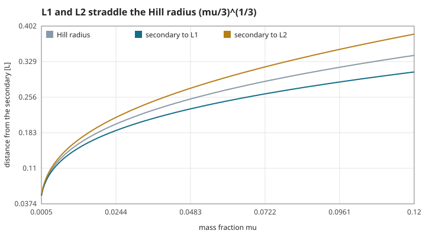

# The circular restricted three-body laboratory

This experiment is separate from the fixed-star model in [page 1](01-gravity-and-orbits.md).
Here **both** primaries orbit their barycentre. The old flight, story, CSV and GIF retain their original model.
Run `make lagrange-plots` to reproduce the CSV tables and SVG figures on this page, or open the browser's **Explore Lagrange points** link.

## S23 — Barycentric units and the rotating equations

**Statement.** Choose primary separation $a=1$ L, total gravitational parameter $G(m_1+m_2)=1$ L³/T² and hence angular frequency $n=1$ T⁻¹. With $\mu=m_2/(m_1+m_2)$, the primaries sit at $(-\mu,0)$ and $(1-\mu,0)$. Define

$$r_1^2=(x+\mu)^2+y^2,\quad r_2^2=(x-1+\mu)^2+y^2,$$
$$\Omega=\tfrac12(x^2+y^2)+\frac{1-\mu}{r_1}+\frac{\mu}{r_2},\qquad
\ddot x=\Omega_x+2\dot y,\quad \ddot y=\Omega_y-2\dot x.$$

Coordinates are L; rotating velocities are L/T. The lab uses $\mu=1/101$: the mass ratio is 1:100, but the separation and time unit differ from free flight.

**Assumptions and limits.** Planar circular primaries, a massless traveller, no thrust, no softening. The point masses are singular. This is not a rotation of the old fixed-star approximation: its star does not recoil and its moon frequency omits the moon's mass.

**Derivation.** Write the inertial position as $\mathbf R=Q(t)\mathbf r$. Differentiating twice gives $Q^T\ddot{\mathbf R}=\ddot{\mathbf r}+2\hat z\times\dot{\mathbf r}+\hat z\times(\hat z\times\mathbf r)$. Moving the latter terms to the force side gives the Coriolis terms and the gradient of the centrifugal potential.

**Code.** `src/cr3bp.c`: `cr3bp_mu`, `cr3bp_potential`, `cr3bp_acceleration`.

**Tests.** `test_jacobi_and_order` compares the potential's independent finite differences to force and verifies both Coriolis signs. The old `orbit.c` remains unchanged.

## S24 — Five equilibria, three scalar roots and two triangles

**Statement.** At rest in the rotating frame, $\nabla\Omega=0$. For $y=0$, solve

$$f(x)=x-\frac{(1-\mu)(x+\mu)}{|x+\mu|^3}-\frac{\mu(x-1+\mu)}{|x-1+\mu|^3}=0.$$

L1 is between the primaries; L2 is beyond the secondary; L3 is beyond the primary. L4 and L5 have $(x,y)=(1/2-\mu,\pm\sqrt3/2)$.

**Assumptions and limits.** $0<\mu\leq1/2$. Equilibrium is not the same as stable motion. The demonstration near L4 is one finite trajectory, not a proof of stability for every mass ratio. The small-mass approximation $|x_{L1,L2}-(1-\mu)|\simeq(\mu/3)^{1/3}$ is an approximation, not the 1e−6 reference.

**Derivation.** On each interval between singularities, $f'(x)=1+2(1-\mu)/|x+\mu|^3+2\mu/|x-1+\mu|^3>0$, so there is one root. Bisection keeps the root bracketed. Setting both primary distances to one gives the two equilateral solutions directly. The production solver uses bisection, while the independent reference uses long-double Newton iterations.

**Code.** `src/cr3bp.c#cr3bp_lagrange` (100 bisections); `src/lagrange.c#lab_point` exposes the same coordinates to WASM.

**Tests.** `test_equilibria`: six mass fractions, independent roots within 1e−6, zero acceleration below 1e−10, equilateral distances and $C_{L4,L5}=3-\mu+\mu^2$. [lagrange.csv](figures/lagrange.csv) records the measured positions, C and force residual.

## S25 — The Jacobi constant

**Statement.** Without thrust, $C=2\Omega-(\dot x^2+\dot y^2)$ is constant, in L²/T². It combines the rotating-frame potential with the rotating velocity; the old star-only `ship_energy` is not this invariant.

**Assumptions and limits.** Primaries are circular, there is no added force, and the trajectory avoids the singularities. Discrete integration only conserves C approximately.

**Derivation.** Differentiate: $\dot C=2\nabla\Omega\cdot\mathbf v-2\mathbf v\cdot\dot{\mathbf v}$. Substitute S23. The two Coriolis products cancel, leaving zero.

**Code.** `src/cr3bp.c#cr3bp_jacobi` uses the same potential as the force.

**Tests.** `test_jacobi_and_order` checks the maximum absolute error at **every step**, for three distinct 60 T trajectories. At dt = 0.0025 T, the worst is 9.36e−8, below 1e−6. The plotted displaced L4 run has maximum 2.22e−15. [jacobi.csv](figures/jacobi.csv) contains 1,501 samples, including rotating velocity and signed C error.

## S26 — RK4 and the observation limit

**Statement.** For state $z=(x,y,v_x,v_y)$ and S23's derivative $F$, use $k_1=F(z)$, $k_2=F(z+h k_1/2)$, $k_3=F(z+h k_2/2)$, $k_4=F(z+h k_3)$ and $z_{n+1}=z_n+h(k_1+2k_2+2k_3+k_4)/6$. This is fourth-order RK4, **not** a symplectic method.

**Assumptions and limits.** Smooth force over a step. Unlike the old position-dependent force, rotating acceleration depends on velocity, so ordinary velocity Verlet cannot be copied unchanged. Long-time energy bounds are not promised. The display advances 16 steps of 0.0025 T per frame, up to 60 T. It rejects a step if C error exceeds 1e−6, becomes nonfinite, or either primary distance is below 0.02 L; the last accepted state is retained.

**Derivation.** Taylor expansion of the four derivative evaluations cancels errors through order four. For a smooth finite interval the global error is $O(h^4)$; halving h should reduce it about sixteenfold. The code measures this independently by three step sizes rather than assuming it from the method's name.

**Code.** `src/cr3bp.c#cr3bp_step`; `src/lagrange.c#lab_tick`.

**Tests.** `test_jacobi_and_order` measures a three-resolution position-difference ratio 17.40 (expected asymptotic value 17 for coarse–fine differences, tending to 16 with an exact reference). `test_lab` checks time, reset, a real L1 crossing and the accepted-state error bound after stopping.

## S27 — Zero velocity, forbidden regions and the L1 neck

**Statement.** The speed satisfies $v^2=2\Omega-C\geq0$. Thus $2\Omega<C$ is forbidden for that C and $2\Omega=C$ is its zero-velocity curve. Let $C_1=2\Omega(L1)$. The L1 throat is closed at $C_1+0.01$ and open at $C_1-0.01$. Opening a throat is a necessary geometric permission, not a guarantee of transit.

**Assumptions and limits.** A planar contour on a finite map $[-1.7,1.7]^2$. A 128×128 grid approximates its shape; unresolved small features are not certified. Grey cell shading samples a coarser grid and is a visual approximation. Changing a comparison level resets the displayed run and **does not** change its physical C.

**Derivation.** Split every grid square along the same diagonal into two triangles; sign-changing edges intersect the level set. Refine each edge intersection with 42 bisections of the actual C potential. Joining those endpoints gives line segments without the ambiguous four-edge saddle case of marching squares. The spatial polygon error remains; tiny endpoint residual is not a claim of exact curved boundaries.

**Code.** `src/cr3bp.c#cr3bp_contours`; `src/lagrange.c#lab_allowed`, `src/lagrange.c#lab_segment`.

**Tests.** `test_contours` tests the two sides of the L1 inequality, finiteness, required-count and bounded-buffer behavior. At the default mass fraction, 1,100/1,096 segments describe the closed/open levels; their maximum endpoint residual is 7.55e−15. Both native and WASM use these C intersections.

## S28 — One calculation, two observation paths

**Statement.** The terminal's `--lagrange <directory>` writes point coordinates, trajectory samples, a Jacobi graph and two contour panels. The browser calls the same C lab API. Reset chooses a reproducible L4 displacement or a point left of L1 moving right; controls change timing and preset, not the equations.

**Assumptions and limits.** Browser plotting uses CSS pixels and system fonts; numerical values have the C model's units. The traveller/primary symbols are enlarged and not art assets. The entry page's navigation changes, while its original physics and story outputs are preserved. No persistent storage, external communication or deployment.

**Derivation.** The numerical state and contours have one C source. Native CSV and exported WASM values can therefore be compared at identical frame boundaries before testing the presentation separately.

**Code.** `src/lagrange.c#lab_reset`, `src/lagrange.c#lab_value`, `src/lagrange.c#lagrange_output`; `web/lagrange.js` draws the results.

**Tests.** `test_lab`, and local `scripts/lagrange-smoke.cjs`: native/WASM 100×13 values, real navigation, both presets, pause/reset/blur, changing boundaries, missing-engine recovery, text ≥14 CSS px and targets ≥44 CSS px in desktop and phone portrait/landscape.

## S29 — One motion, two frames

**Statement.** With the frames coincident at $t=0$ and the rotating frame turning counter-clockwise at $n=1$, a rotating state $(x,y,v_x,v_y)$ is the inertial state

$$X=x\cos t-y\sin t,\quad Y=x\sin t+y\cos t,$$
$$V_X=(v_x-y)\cos t-(v_y+x)\sin t,\quad V_Y=(v_x-y)\sin t+(v_y+x)\cos t .$$

The Jacobi constant of S25 is the inertial energy minus angular momentum: $C=-2(E-h)$, with $E=\tfrac12V^2-(1-\mu)/r_1-\mu/r_2$ and $h=XV_Y-YV_X$. Neither $E$ nor $h$ is conserved alone, because the primaries move.

**Assumptions and limits.** Planar motion, circular primaries, $n=1$. The transform is exact algebra; it adds no physics. The Coriolis term $2(v_y,-v_x)$ and the centrifugal term $(x,y)$ of S23 exist only in the rotating description.

**Derivation.** Rotate the position by the angle $t$. Differentiating $X(t)$ gives the rotated $(v_x,v_y)$ plus $\hat z\times(x,y)=(-y,x)$, also rotated. Substituting, $V^2=v^2+2(xv_y-yv_x)+x^2+y^2$ and $h=xv_y-yv_x+x^2+y^2$, so $E-h=\tfrac12v^2-\tfrac12(x^2+y^2)-(1-\mu)/r_1-\mu/r_2=-C/2$.

**Code.** `src/cr3bp.c#cr3bp_to_inertial`, `src/cr3bp.c#cr3bp_to_rotating`; the browser's frame switch reads the inertial position from C.

**Tests.** `test_frames`: the round trip over 4,001 states returns within 8.9e−16; $C+2(E-h)$ stays within 5.3e−15; the secondary's inertial speed and radius are $1-\mu$. An independent RK4 of plain Newtonian gravity from two circling primaries, with no fictitious force, agrees with the rotating integration to 1.29e−8 L after 20 T (dt 0.00125 T).

## S30 — Linearised motion about a Lagrange point

**Statement.** For a small offset $(\xi,\eta)$ from an equilibrium,

$$\ddot\xi-2\dot\eta=\Omega_{xx}\xi+\Omega_{xy}\eta,\qquad \ddot\eta+2\dot\xi=\Omega_{xy}\xi+\Omega_{yy}\eta .$$

Solutions $e^{\lambda t}$ satisfy, with $s=\lambda^2$,

$$s^2+(4-\Omega_{xx}-\Omega_{yy})\,s+(\Omega_{xx}\Omega_{yy}-\Omega_{xy}^2)=0 .$$

A negative real $s$ is an oscillation of angular frequency $\sqrt{-s}$; a positive real $s$, or a complex pair, contains a growing mode with rate $\mathrm{Re}\,\lambda>0$. An eigenvector is $(\xi,\eta)\propto(2\lambda+\Omega_{xy},\ \lambda^2-\Omega_{xx})$.

**Assumptions and limits.** First order in the offset only. "Linearly stable" means no growing exponential in this equation; it is not a proof of stability for all time or for finite displacements.

**Derivation.** Expand $\nabla\Omega$ of S23 to first order about a point where it vanishes; the Coriolis terms are already linear. Insert $e^{\lambda t}$ and require a non-trivial solution of the 2×2 system: $(\lambda^2-\Omega_{xx})(\lambda^2-\Omega_{yy})-(\Omega_{xy}+2\lambda)(\Omega_{xy}-2\lambda)=0$, which is the quartic above. The first row gives the eigenvector.

**Code.** `src/cr3bp.c#cr3bp_hessian`, `src/cr3bp.c#cr3bp_modes`, `src/cr3bp.c#cr3bp_mode_start`.

**Tests.** `test_stability` compares the analytic second derivatives with central differences of the acceleration at five mass fractions (within 1e−6), checks the closed forms at L4 and that L5 has the same modes.

## S31 — L1, L2 and L3 are saddles

**Statement.** At each collinear point $\Omega_{xy}=0$, $\Omega_{xx}>0$ and $\Omega_{yy}<0$, so the quartic has one positive and one negative root $s$: one growing/decaying pair and one oscillation, at every mass fraction. At $\mu=1/101$ the growth rates are 2.9023, 2.1806 and 0.1607 per T for L1, L2, L3.

**Assumptions and limits.** As S30. A saddle still has bounded linear orbits (the oscillating mode); only a generic nudge leaves. The measured run stays in the linear range (1e−8 L to about 6e−5 L).

**Derivation.** On the axis, with $A=(1-\mu)/r_1^3+\mu/r_2^3$, $\Omega_{xx}=1+2A$ and $\Omega_{yy}=1-A$. Equilibrium on the axis forces $A>1$ at all three points, so the constant term $\Omega_{xx}\Omega_{yy}<0$ and the two roots $s$ have opposite signs.

**Code.** `src/cr3bp.c#cr3bp_modes`; `src/lagrange.c#lab_measured_growth` integrates the pure mode for 3 T.

**Tests.** `test_stability`: for 15 points (L1–L3 × five mass fractions from 0.001 to 0.5) the integrated e-folding rate matches the eigenvalue within 1.85e−5 relative. Values at the default mass fraction are in [stability.csv](figures/stability.csv).

## S32 — Libration about L4 and L5

**Statement.** At L4/L5, $\Omega_{xx}=3/4$, $\Omega_{yy}=9/4$, $\Omega_{xy}=\pm\tfrac{3\sqrt3}{4}(1-2\mu)$, so

$$\omega^4-\omega^2+\tfrac{27}{4}\mu(1-\mu)=0 .$$

Below Routh's limit (S33) there are two real frequencies: a short-period mode near the orbital period and a long-period mode. At $\mu=1/101$: periods 6.5197 T and 23.5396 T.

**Assumptions and limits.** As S30. A finite displacement mixes the modes and stretches along the orbit into a "tadpole": the lab's 0.01 L nudge ends 0.113 L from L4 after 60 T, bounded but far outside the linear range.

**Derivation.** Both primaries are at distance 1 from L4, at $(\mp\tfrac12,-\tfrac{\sqrt3}{2})$ relative to it. Summing the two point-mass Hessians with weights $1-\mu$ and $\mu$, plus the identity from the centrifugal term, gives the three values. Insert them in S30 with $s=-\omega^2$.

**Code.** `src/cr3bp.c#cr3bp_modes`, `src/cr3bp.c#cr3bp_mode_start`; `src/lagrange.c#lab_measured_period` times successive upward zero crossings of $\eta$.

**Tests.** `test_stability`: measured periods 6.519731926 T and 23.539610506 T against $2\pi/\omega$ = 6.519728535 T and 23.539634264 T (relative differences 5.2e−7 and 1.0e−6); the quartic residual is below 1e−13.

## S33 — Routh's condition

**Statement.** L4 and L5 are linearly stable only if $\mu(1-\mu)<1/27$, that is

$$\mu<\mu_R=\tfrac12\left(1-\sqrt{23/27}\right)=0.0385208965 .$$

Above it the two frequencies have merged and the motion is a growing spiral. At $\mu=0.05$ the rate is 0.1820 per T.

**Assumptions and limits.** Linear criterion in the planar circular problem. At exactly $\mu_R$, and at certain resonant mass fractions below it, nonlinear terms decide; this lab does not test those cases.

**Derivation.** The quadratic in $\omega^2$ of S32 has real roots only when its discriminant $1-27\mu(1-\mu)\ge0$. Solving the equality for the smaller root gives $\mu_R$. Past it $s$ is complex and $\mathrm{Re}\,\lambda=\sqrt{(|s|+\mathrm{Re}\,s)/2}>0$.

**Code.** `src/cr3bp.c#cr3bp_routh`, `src/cr3bp.c#cr3bp_modes`; `src/lagrange.c#lab_measured_drift`; the browser slider calls `src/lagrange.c#lab_set_mu`.

**Tests.** `test_stability`: bisection for the first mass fraction with a non-zero growth rate lands within 1e−12 of the closed form. After a 1e−8 L nudge, 70 T: at $\mu=0.03$ the distance never exceeds 1.92e−7 L; at $\mu=0.05$ it reaches 0.0177 L, with a fitted rate 0.18253 per T against 0.18199 (0.3 %). `test_lab_mu` runs the lab at $\mu=0.3$ until it stops more than 0.1 L from L4.

## S34 — The Hill radius is where L1 and L2 sit, approximately

**Statement.** For small $\mu$ the distances from the secondary to L1 and L2 tend to the Hill radius $r_H=(\mu/3)^{1/3}$; to next order $d\approx r_H(1\mp r_H/3)$, L1 inside and L2 outside.

**Assumptions and limits.** An asymptotic statement. At $\mu=1/101$, $r_H=0.148886$ L while L1 and L2 are at 0.141475 L and 0.156221 L (−4.98 %, +4.93 %). The collinear roots of S24, not this formula, are what the code uses.

**Derivation.** Near the secondary write $x=1-\mu\pm d$ and expand the primary's pull and the centrifugal term to first order in $d$: their difference is the tidal term $3d$. Balance with the secondary's $\mu/d^2$: $3d^3=\mu$.

**Code.** `src/cr3bp.c#cr3bp_lagrange`; `src/lagrange.c#lab_value` reports `LAB_HILL` to the browser.

**Tests.** `test_equilibria` (ratio within 0.1 % at $\mu$ = 1e−9) and `test_stability` (within 8 % and bracketing at 1/101; the next-order formula within 0.002 L).

## Sources

Consulted 2026-11-13; derivations and figures above are written and generated for this implementation.

- Richard Fitzpatrick, University of Texas: [circular restricted problem and units](https://farside.ph.utexas.edu/teaching/celestial/Celestialhtml/node80.html).
- Fitzpatrick: [co-rotating frame and Jacobi integral](https://farside.ph.utexas.edu/teaching/celestial/Celestial/node83.html).
- Fitzpatrick: [Lagrange points](https://farside.ph.utexas.edu/teaching/celestial/Celestial/node84.html), [zero-velocity surfaces](https://farside.ph.utexas.edu/teaching/celestial/Celestialhtml/node85.html).
