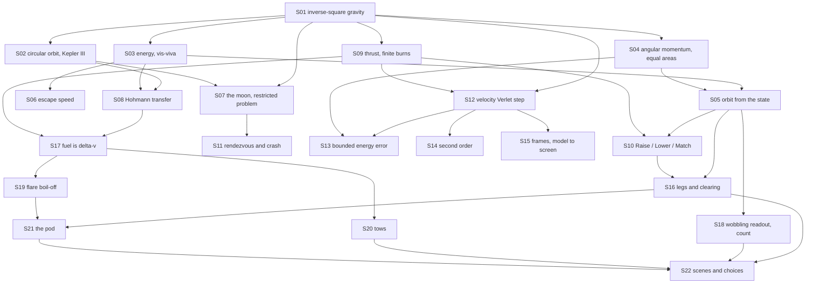

# Theory handbook

Why the program is correct, from the repository alone: every law, numerical rule and game rule the code relies on, each stated in Markdown **with a figure**, the place in the code that implements it, and the test or measurement that checks it.

- Units: lengths in L, times in T, chosen so that the star's $GM = 1$. Speeds are L/T; fuel is counted in L/T of delta-v.
- Plotted figures and the numbers quoted in the text are produced by the program's own functions: `make theory-figs` rewrites [figures/](figures/) and [figures/values.md](figures/values.md). Diagrams are Mermaid, written in the pages.
- `make theory-check` fails when a statement has no figure, a link is broken, a referenced function or test no longer exists, or a public function is missing from the tables below.

## Pages

1. [Gravity and orbits](01-gravity-and-orbits.md) — the inverse-square law, circular orbits and Kepler's third law, energy and vis-viva, angular momentum and equal areas, the orbit from the state, escape speed, the moon
2. [Transfers and burns](02-transfers.md) — the Hohmann transfer, thrust and finite burns, Raise / Lower / Match, rendezvous and crash
3. [The integrator, the frame and the screen](03-integrator.md) — the velocity Verlet step, why its energy error stays bounded, second-order accuracy, the path from a key press to the picture
4. [The Ice Run: the rules of the game layer](04-ice-run.md) — legs and clearing, fuel as delta-v, the wobbling readout, the flare, tows, the pod, scenes
5. [The rotating three-body laboratory](05-rotating-three-body.md) — barycentric units, L1–L5, Jacobi conservation, RK4, zero-velocity curves, the inertial frame, linear stability, libration periods, Routh's condition and the Hill radius

## How the pieces depend on each other

## Coverage: statement → page → figure → code → test

| ID | Statement | Page | Figure | Code | Test |
|---|---|---|---|---|---|
| S01 | Inverse-square gravity, softened | [1](01-gravity-and-orbits.md) | `figures/gravity.svg` | `src/orbit.c#gravity` | `tests/test_orbit.c#test_circular_orbit_period`, `tests/theory_figs.c#accel-r1` |
| S02 | Circular speed and period, $T^2 \propto r^3$ | [1](01-gravity-and-orbits.md) | `figures/period.svg` | `src/orbit.c#circular_speed`, `src/orbit.c#circular_period` | `tests/test_orbit.c#test_circular_orbit_period` |
| S03 | Specific energy and vis-viva | [1](01-gravity-and-orbits.md) | `figures/visviva.svg` | `src/orbit.c#ship_energy` | `tests/test_orbit.c#test_energy_and_momentum_drift_are_tiny` |
| S04 | Angular momentum, equal areas | [1](01-gravity-and-orbits.md) | `figures/areal.svg` | `src/orbit.c#ship_ang_momentum` | `tests/test_orbit.c#test_energy_and_momentum_drift_are_tiny` |
| S05 | Semi-major axis, eccentricity, apsides from the state | [1](01-gravity-and-orbits.md) | `figures/elements.svg`, mermaid | `src/voyage.c#elements`, `src/voyage.c#voyage_value` | `tests/theory_figs.c#apo-from-state` |
| S06 | Escape speed $\sqrt{2GM/r}$ | [1](01-gravity-and-orbits.md) | `figures/escape.svg` | `src/orbit.c#ship_energy` | `tests/test_orbit.c#test_escape_speed_gives_zero_energy` |
| S07 | The moon's circle; restricted three-body problem | [1](01-gravity-and-orbits.md) | `figures/energy-moon.svg` | `src/orbit.c#moon_omega`, `src/orbit.c#moon_position` | `tests/test_orbit.c#test_moon_is_on_a_circle` |
| S08 | Hohmann transfer: two impulses and half an ellipse | [2](02-transfers.md) | `figures/hohmann.svg`, `figures/hohmann-cost.svg`, mermaid | `src/flight.c#flight_reset`, `src/flight.c#impulse` | `tests/test_orbit.c#test_hohmann_transfer_reaches_the_target_radius`, `tests/test_flight.c#transfer_bench` |
| S09 | Thrust adds $a_T t$; long burns reach less far | [2](02-transfers.md) | `figures/thrust.svg`, `figures/finite-burn.svg` | `src/orbit.c#orbit_step` | `tests/test_orbit.c#test_thrust_adds_speed` |
| S10 | Raise / Lower / Match and the apsides | [2](02-transfers.md) | `figures/apsides.svg` | `src/voyage.c#match_vector`, `src/voyage.c#voyage_tick` | `tests/theory_figs.c#match-eccentricity` |
| S11 | Rendezvous, crash, relative speed | [2](02-transfers.md) | mermaid | `src/flight.c#flight_tick`, `src/flight.c#flight_value` | `tests/test_flight.c#manual_matches_existing_integrator`, `tests/theory_figs.c#rel-speed-start` |
| S12 | Velocity Verlet: half kick, drift, half kick | [3](03-integrator.md) | mermaid | `src/orbit.c#orbit_step` | `tests/test_flight.c#manual_matches_existing_integrator`, `tests/theory_figs.c#verlet-one-step` |
| S13 | Symplectic and reversible: bounded energy error | [3](03-integrator.md) | `figures/energy-drift.svg` | `src/orbit.c#orbit_step` | `tests/test_orbit.c#test_energy_and_momentum_drift_are_tiny`, `tests/theory_figs.c#verlet-reversal` |
| S14 | Second-order accuracy | [3](03-integrator.md) | `figures/order.svg` | `src/orbit.c#orbit_step` | `tests/theory_figs.c#verlet-order-energy` |
| S15 | Frames of ten steps; from a key to the picture | [3](03-integrator.md) | mermaid | `src/flight.c#flight_tick`, `src/voyage.c#voyage_tick`, `src/render.c#render_frame` | `tests/test_voyage.c#no flat waits`, `tests/test_orbit.c#test_render_fits_the_screen` |
| S16 | Legs, target rings, the clearing rule | [4](04-ice-run.md) | `figures/clearing.svg` | `src/voyage.c#start_leg`, `src/voyage.c#CLEAR_A` | `tests/test_voyage.c#[mech] route` |
| S17 | Fuel is delta-v | [4](04-ice-run.md) | `figures/fuel.svg` | `src/voyage.c#voyage_tick`, `src/voyage.c#voyage_answer` | `tests/test_voyage.c#[mech] dock` |
| S18 | The wobbling readout and Ilse's count | [4](04-ice-run.md) | `figures/wobble.svg` | `src/voyage.c#voyage_wobble`, `src/voyage.c#voyage_cue` | `tests/test_voyage.c#[mech] dock` |
| S19 | Flare boil-off $\propto 1/r^2$ | [4](04-ice-run.md) | `figures/boil.svg` | `src/voyage.c#voyage_boil` | `tests/test_voyage.c#[mech] flare` |
| S20 | Tows: the drone and the carry | [4](04-ice-run.md) | `figures/tow.svg`, mermaid | `src/voyage.c#tow` | `tests/test_voyage.c#[mech] silence` |
| S21 | The pod's grapple and the 11 T wait | [4](04-ice-run.md) | mermaid | `src/voyage.c#voyage_hold_need` | `tests/test_voyage.c#[mech] ilse` |
| S22 | Scenes, choices, heavy scenes, endings | [4](04-ice-run.md) | mermaid | `src/voyage.c#voyage_init`, `src/voyage.c#voyage_answer`, `src/voyage.c#voyage_options`, `src/voyage.c#voyage_heavy`, `src/voyage.c#voyage_ending` | `tests/test_voyage.c#[quiet] flare`, `tests/test_voyage.c#[choice]` |
| S23 | Barycentric units, potential and Coriolis acceleration | [5](05-rotating-three-body.md) | mermaid | `src/cr3bp.c#cr3bp_mu`, `src/cr3bp.c#cr3bp_potential`, `src/cr3bp.c#cr3bp_acceleration` | `tests/test_cr3bp.c#test_jacobi_and_order` |
| S24 | Three collinear roots and two equilateral points | [5](05-rotating-three-body.md) | `figures/zero-velocity.svg` | `src/cr3bp.c#cr3bp_lagrange`, `src/lagrange.c#lab_point` | `tests/test_cr3bp.c#test_equilibria` |
| S25 | Jacobi conservation along trajectories | [5](05-rotating-three-body.md) | `figures/jacobi.svg` | `src/cr3bp.c#cr3bp_jacobi` | `tests/test_cr3bp.c#test_jacobi_and_order` |
| S26 | RK4 and the accepted-state accuracy limit | [5](05-rotating-three-body.md) | mermaid | `src/cr3bp.c#cr3bp_step`, `src/lagrange.c#lab_tick` | `tests/test_cr3bp.c#test_jacobi_and_order`, `tests/test_cr3bp.c#test_lab` |
| S27 | Zero-velocity contours and forbidden regions | [5](05-rotating-three-body.md) | `figures/zero-velocity.svg` | `src/cr3bp.c#cr3bp_contours`, `src/lagrange.c#lab_allowed`, `src/lagrange.c#lab_segment` | `tests/test_cr3bp.c#test_contours` |
| S28 | Shared native/WASM observation controller | [5](05-rotating-three-body.md) | mermaid | `src/lagrange.c#lab_reset`, `src/lagrange.c#lab_value`, `src/lagrange.c#lagrange_output` | `tests/test_cr3bp.c#test_lab`, `scripts/lagrange-smoke.cjs#nativeWasm` |
| S29 | Rotating and inertial frames; C = −2(E − h) | [5](05-rotating-three-body.md) | `figures/frames.svg` | `src/cr3bp.c#cr3bp_to_inertial`, `src/cr3bp.c#cr3bp_to_rotating` | `tests/test_cr3bp.c#test_frames` |
| S30 | Linearised motion and the characteristic equation | [5](05-rotating-three-body.md) | `figures/l4-modes.svg` | `src/cr3bp.c#cr3bp_hessian`, `src/cr3bp.c#cr3bp_modes`, `src/cr3bp.c#cr3bp_mode_start` | `tests/test_cr3bp.c#test_stability` |
| S31 | L1–L3 are saddles at every mass fraction | [5](05-rotating-three-body.md) | `figures/collinear-growth.svg` | `src/cr3bp.c#cr3bp_modes`, `src/lagrange.c#lab_measured_growth` | `tests/test_cr3bp.c#test_stability` |
| S32 | L4/L5 libration: two periods | [5](05-rotating-three-body.md) | `figures/l4-libration.svg` | `src/cr3bp.c#cr3bp_mode_start`, `src/lagrange.c#lab_measured_period` | `tests/test_cr3bp.c#test_stability` |
| S33 | Routh's condition for L4/L5 | [5](05-rotating-three-body.md) | `figures/l4-routh.svg` | `src/cr3bp.c#cr3bp_routh`, `src/lagrange.c#lab_measured_drift`, `src/lagrange.c#lab_set_mu` | `tests/test_cr3bp.c#test_stability`, `tests/test_cr3bp.c#test_lab_mu` |
| S34 | Hill radius as the small-mass limit of L1/L2 | [5](05-rotating-three-body.md) | `figures/hill.svg` | `src/cr3bp.c#cr3bp_lagrange`, `src/lagrange.c#lab_value` | `tests/test_cr3bp.c#test_equilibria`, `tests/test_cr3bp.c#test_stability` |

Tests named `tests/theory_figs.c#…` are measurements recorded in [figures/values.md](figures/values.md) by `make theory-figs`, not assertions of `make test`. S05, S10 and S14 are covered only that way: the orbital elements, the Match command and the order of the integrator are exercised by the story tests and the bench but have no assertion of their own. Turning them into assertions is a follow-up.

Two things the measurements made visible:

- `ship_energy` uses the unsoftened potential while `gravity` softens the force by 1e-6, so the reported energy has a small part that no step size removes (`softening-floor`, S14). It is far below the 0.001 tolerance of the unit test and is not a defect of the integrator.
- The end conditions of the manual mode (S11) are checked only in the browser smoke test.

## Public functions that state no law

| Function | What it is |
|---|---|
| `src/orbit.c#world_default` | the constants: star $GM = 1$, moon $GM = 0.01$ on the ring 3, thrust 0.02 |
| `src/svg.c#svg_plot` | writes the line charts of this handbook and of `make plots` |
| `src/gif.c#gif_open`, `src/gif.c#gif_frame`, `src/gif.c#gif_close`, `src/gif.c#gif_text_size`, `src/gif.c#gif_draw_text` | GIF89a/LZW encoder for the demo animation |

## Reading the source against this table

Functions reviewed for this handbook: every declaration in `src/orbit.h`, `src/flight.h`, `src/voyage.h`, `src/render.h`, `src/svg.h` and `src/gif.h`; the static helpers `impulse` in `src/flight.c` and `elements`, `match_vector`, `open_scene`, `raise_banner`, `start_leg`, `clear_leg`, `tow` in `src/voyage.c`; `headless` in `src/main.c`; and the wrappers of `src/voyage_web.c`, which only forward to `voyage_init`, `voyage_tick`, `voyage_answer` and `voyage_value`. The bench's pilot (`tests/voyage_policy.h`) is test code, not a rule of the game, and is described in `docs/design.md`.

S01–S22 document the original simulation and game. S23–S34 add the separate barycentric CR3BP experiment; the original `orbit.c` and `voyage.c` remain unchanged. `make theory-figs` also runs `make lagrange-plots` for the new figures and CSV tables.
